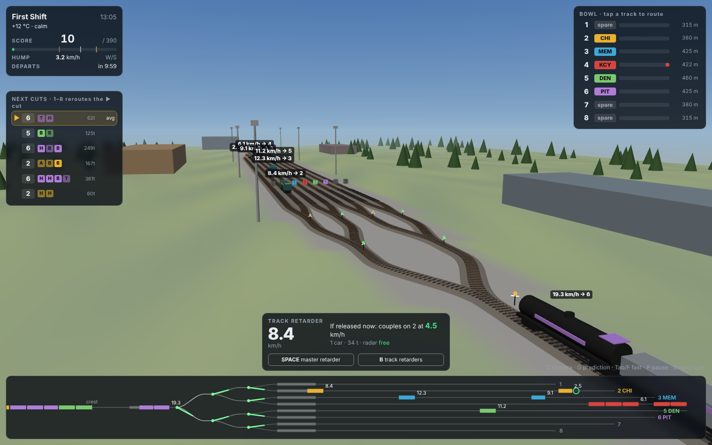
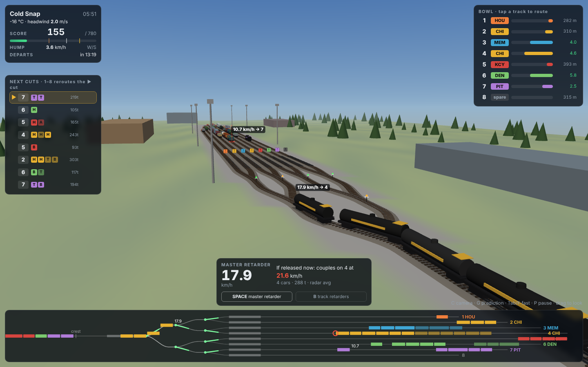
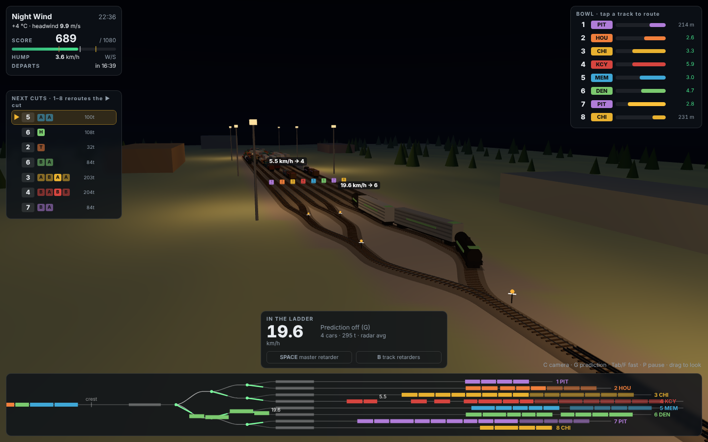
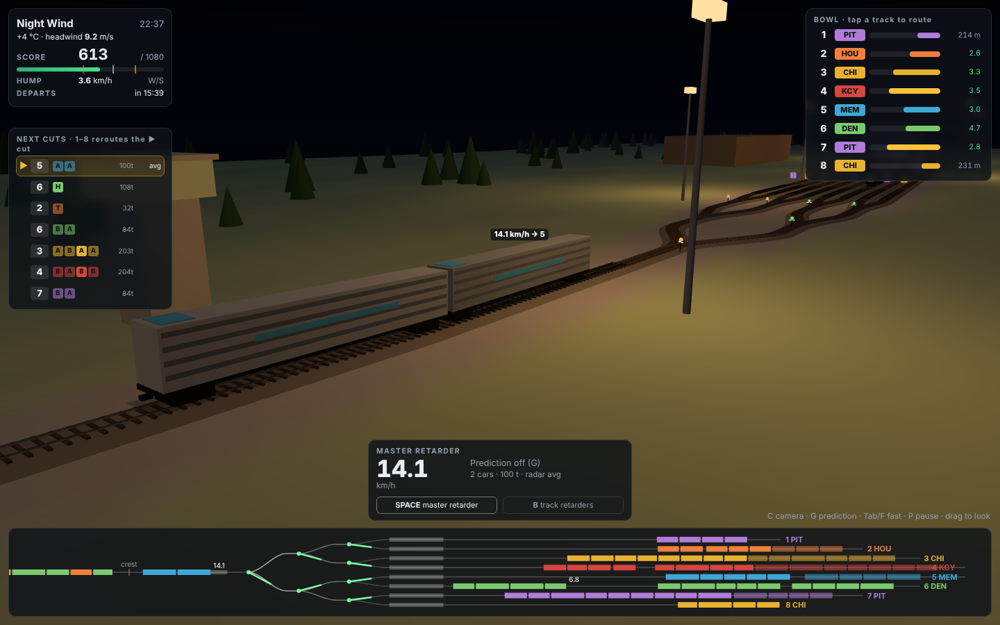
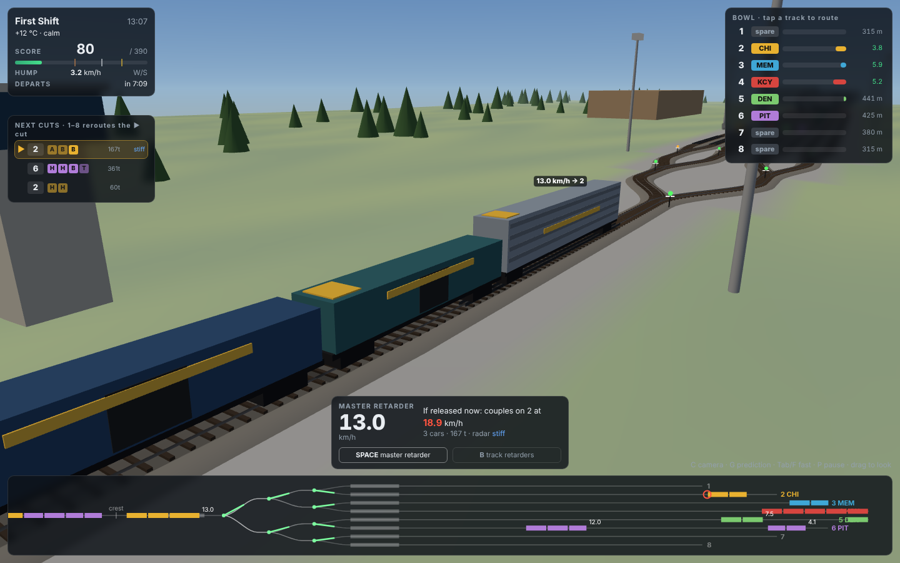
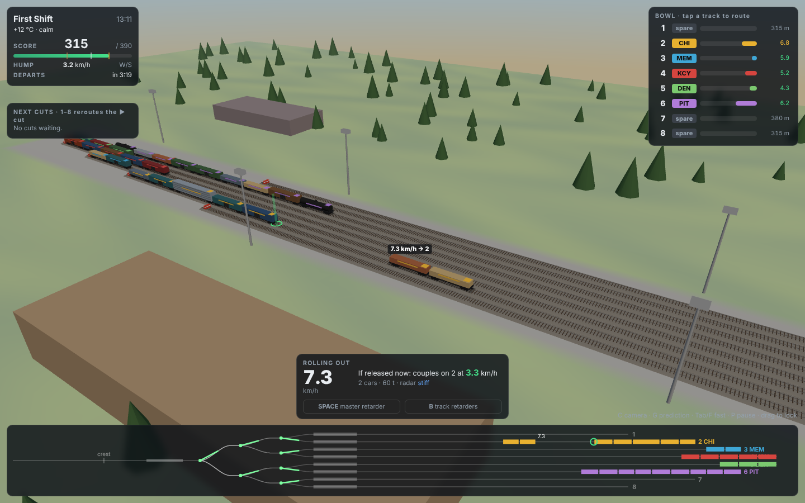
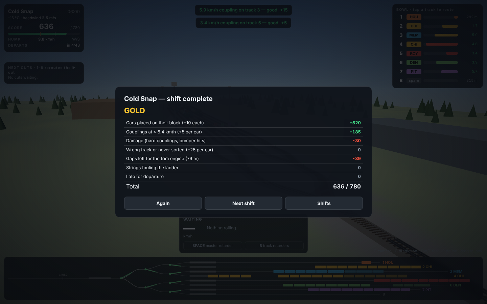
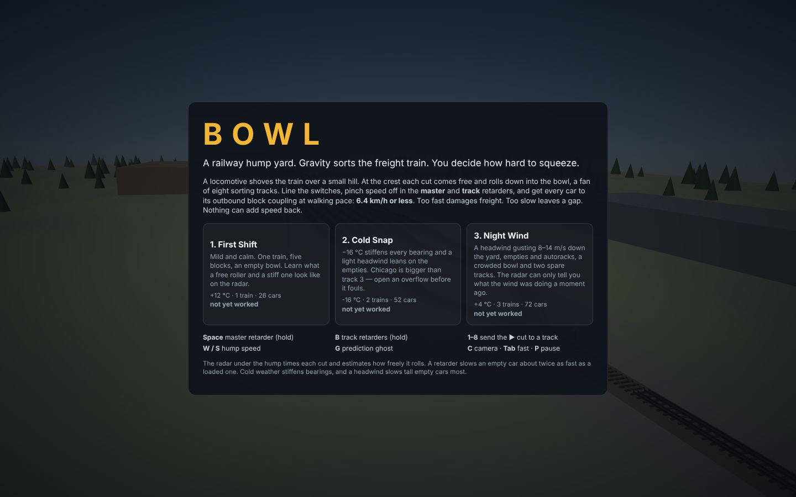
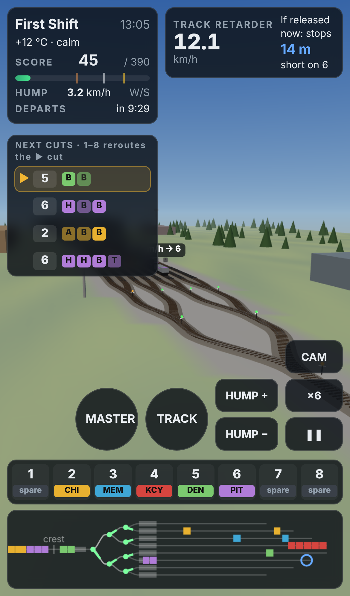

# Bowl

**A 3D railway hump yard. Gravity sorts the freight train; you decide how hard
to squeeze.** A locomotive shoves a mixed train over a small hill. At the crest
each cut (1–4 cars for the same destination) comes free and rolls down through
a ladder of switches into the bowl, a fan of eight sorting tracks. You line the
switches and work two sets of rail brakes, the *master* and *track* retarders,
so that every cut couples to the cars already on its track at walking pace.
Nothing can add speed back once you have taken it off.

| Tower view, the ladder and track retarders | Cold Snap, after the second train |
|:---:|:---:|
|  |  |

| Night Wind | A cut in the master retarder at night | Following a cut |
|:---:|:---:|:---:|
|  |  |  |

| The bowl | Shift result | Title | Phone |
|:---:|:---:|:---:|:---:|
|  |  |  |  |

## Run it

```bash
cd showcase/apps/bowl
python3 -m http.server 8080
# open http://localhost:8080
```

No build step and no network. Three.js r163 is vendored in `vendor/`.

## How to play

| Input | Action |
|---|---|
| **Space** (hold) | Master retarder, on the hump lead. Every cut passes through it |
| **B** (hold) | Track retarders at the entrance to all eight bowl tracks |
| **1–8** | Send the ▶ cut in the queue to that track. On a spare track this opens it for that cut's block |
| **W / S** or **↑ / ↓** | Hump speed, 0–7.9 km/h |
| **G** | Prediction ghost on/off |
| **C** | Camera: tower, crest, follow, bowl |
| Drag / wheel | Orbit / zoom |
| **Tab** (hold) / **F** | Fast-forward ×6 (the sim normally runs at ×2) |
| **P** / **Esc** | Pause |

On a phone, the round buttons are the two retarders. Tap a track number in the
strip above the diagram to route the next cut.

Every cut is auto-lined to its block's track. Your jobs:

- **Couple softly.** 6.4 km/h (4 mph) or less earns +5 per car. Up to 9.7 km/h
  is firm (0). Anything harder damages freight (−30, or −80 above 14.4 km/h).
  Stopping short leaves a gap the trim engine has to close (−0.5 per metre).
- **Read the radar.** As each cut runs down the steep part of the hump, the
  yard backs its rolling resistance out of the energy it gained. The queue and
  gauge show *free*, *avg* or *stiff*. Free rollers on an empty track will
  reach the bumper unless you brake them, and stiff cars in the cold may never
  reach the string at all.
- **Mind the weight.** Retarder force is partly fixed and partly proportional
  to weight, so a 30 t empty slows about twice as fast as a 120 t load. Heavy
  cuts need the master retarder as well as the track retarder.
- **Keep the switches clear.** A switch cannot be thrown while a car is between
  its points and its fouling point. If a fast cut catches a slow one before
  their routes part, it follows the slow one onto the wrong track.
- **Watch capacity.** When a block's track fills up (red bar), press a spare
  track's number to open an overflow. A string backed into the ladder fouls it
  (−40). If it backs up over the crest and blocks the hump for 90 s, the shift
  is called off.

Score = +10 per car on its block's track, coupling grades, −25 per car on the
wrong track or never sorted, gaps, fouling, and −1 per second late. Gold is
80% of 15 points per car, silver 65%, bronze 45%.

### Shifts

| Shift | Conditions | What it teaches |
|---|---|---|
| **First Shift** | +12 °C, calm, 1 train, 26 cars, empty bowl, prediction on | Free vs stiff rollers, first car on an empty track |
| **Cold Snap** | −16 °C (rr ×1.63), 3 m/s headwind, 2 trains, strings already standing | Stiff bearings, opening an overflow for an oversized block |
| **Night Wind** | +4 °C, night, headwind gusting 8–14 m/s, 3 trains, 72 cars, prediction off | Empty autoracks in wind, a crowded bowl, switch conflicts |

## Physics

All of it lives in `src/sim.js`, with geometry in `src/track.js`.

- **Profile.** The approach climbs at 1.2% to the crest. Then 4.0% for 35 m,
  1.5% through the master retarder (42–78 m), 0.8% through the ladder (switches
  at 95, 135 and 175 m, with curve resistance in each turnout), 0.6% through
  the track retarders (207–250 m), 0.3% at the bowl entry and 0.05% for the
  rest. Tracks are 315–460 m long.
- **Forces per car.** Grade `m·g·grade(s)` at each car's own centre, so a cut
  straddling the crest is held back by its rear car. Rolling resistance is
  `m·g·rr·cold`, with rr from 0.0012 to 0.0045 (empties +0.0005), and +3% per
  °C below 5 °C. Drag is `½ρ·CdA·v_rel|v_rel|` along the yard, full CdA on the
  lead car and 30% on the rest. Rotating wheelsets add 5% effective mass.
  Breakaway resistance is 1.6× rolling.
- **Retarders.** Master 40 kN + 0.65 N/kg, track 25 kN + 0.5 N/kg, applied
  only to cars whose centres are inside the retarder. Inert retarders in the
  bowl hold standing cars against the wind.
- **Couplings.** Perfectly inelastic with momentum conserved. Strings that are
  hit roll on together.
- **Routing.** Seven switches in a three-level binary ladder. The router lines
  each switch for the nearest cut approaching it, but only when no car is
  between 3 m before the points and 28 m past them. A cut's front takes
  whichever leg the switch is lined for when it arrives.
- **Prediction.** The gauge and the ghost marker roll the focused cut forward
  alone, on the radar's rr estimate and a blend of the gust and the forecast
  wind, against what is standing on its track. Cuts still rolling ahead are
  predicted first.

## Bench

```bash
node scripts/bench.mjs
```

The bench runs headless in Node and checks:

- free-roll deceleration against `g(rr − grade)/1.05`
- hump descent speed against the energy balance
- retarder deceleration, empty vs loaded
- momentum conservation at a coupling
- that an occupied switch stays locked and produces a misroute (and doesn't when clear)
- determinism
- the car ledger on every shift
- radar accuracy (RMS 2.9e-4)
- on every shift: the expert bot takes gold, a no-brake bot loses 1,300–2,200
  points to damage, and a no-route bot misroutes

The expert bot (`src/bot.js`) uses only the radar estimate and the inputs a
player has.

`scripts/screens.mjs` regenerates the screenshots (serve the folder on :8097
first).

## Files

```
index.html, style.css
src/track.js    yard geometry, grade profile, switch ladder
src/shifts.js   car types, blocks, the three shifts, seeded train generation
src/sim.js      physics, routing, radar, couplings, scoring, prediction
src/bot.js      expert / no-brake / no-route bots
src/scene.js    Three.js yard, rolling stock, retarders, cameras
src/hud.js      panels, queue, track board, gauge, yard diagram
src/audio.js    retarder squeal, coupler clank, diesel, wind (Web Audio)
src/main.js     loop, input, focus and prediction
scripts/        bench and screenshot scripts
PRD.md          the product requirements this was built from
```
