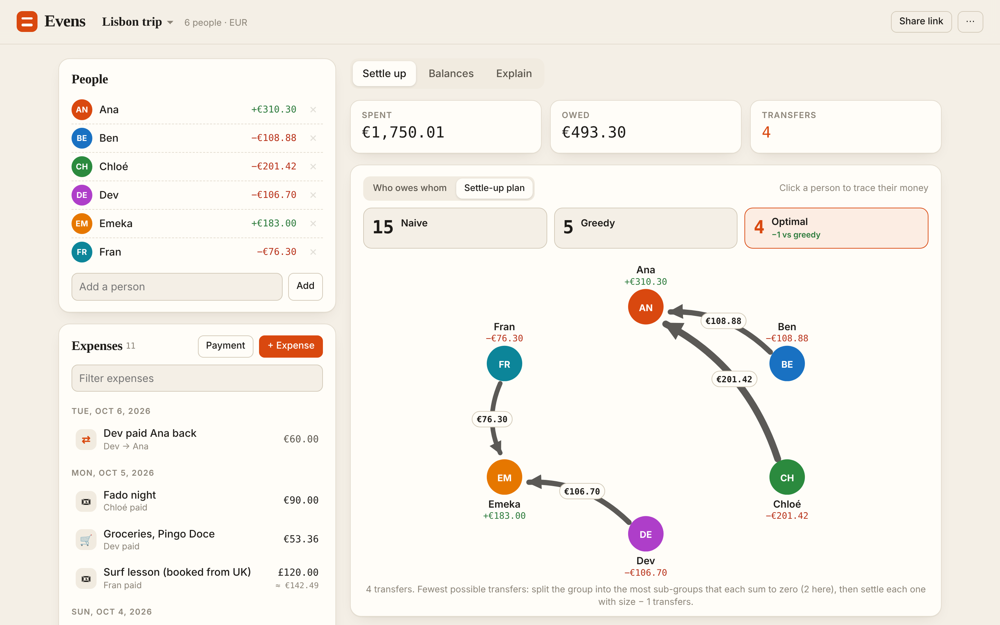
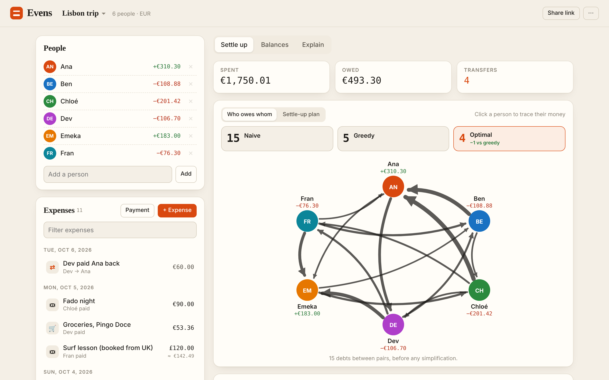
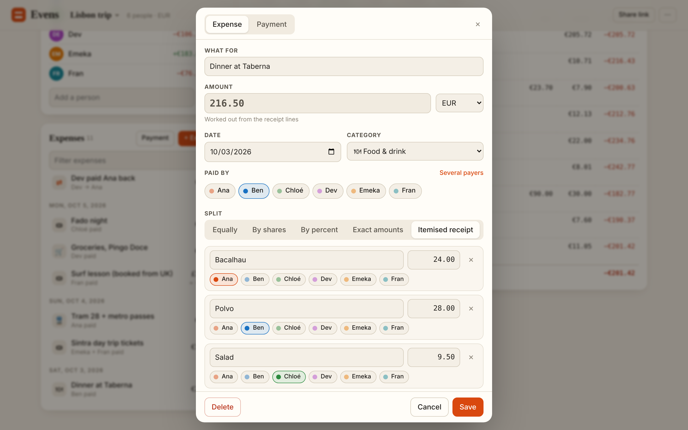
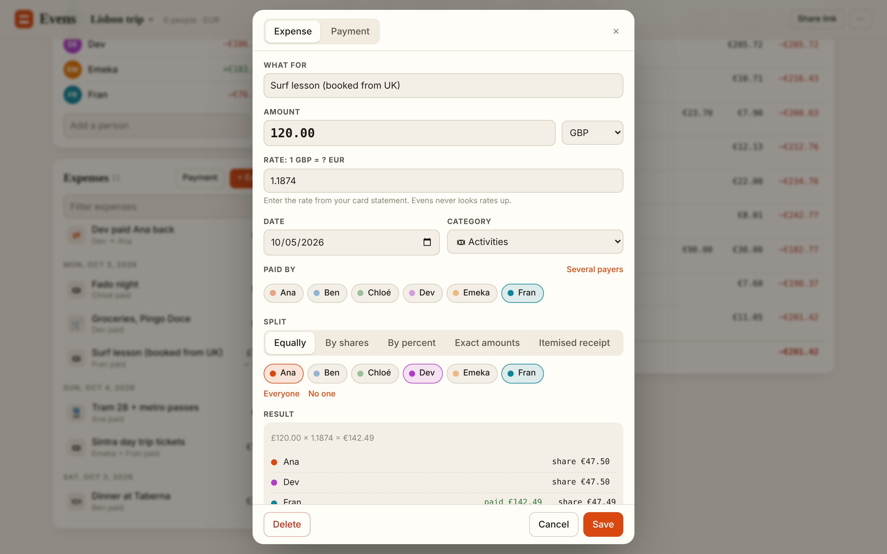
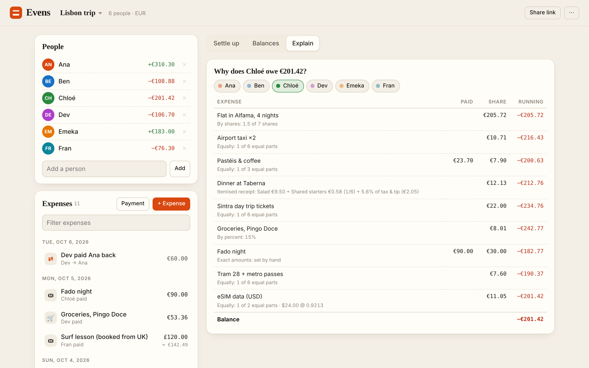
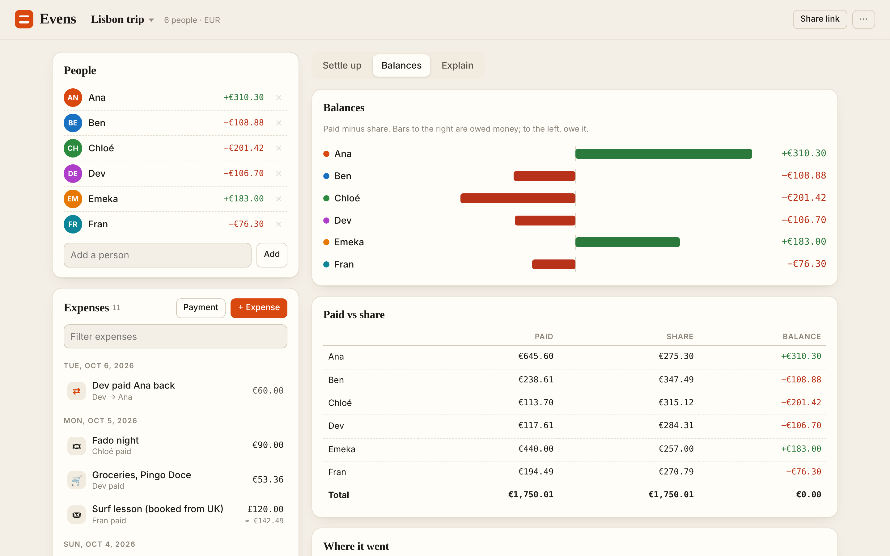
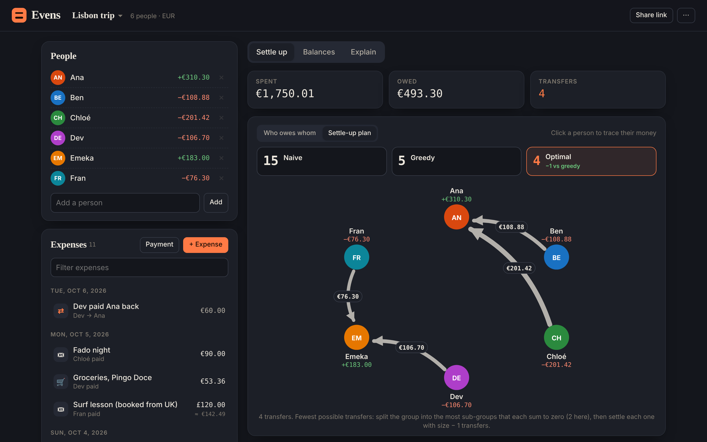
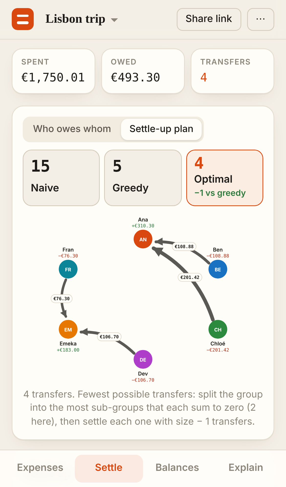

# Evens

**Split a trip, a flat or a dinner to the cent, then settle it with the fewest
possible bank transfers.** Add people and expenses. Each expense can be split
equally, by shares, by percent, by exact amounts or from an itemised receipt
with tax and tip, and each can be in its own currency. Evens works out
everyone's balance and draws the debts as a graph. It then compares three
settle-up plans: naive, greedy and a provably minimal one. Every number can be
traced back to the cent on the Explain tab.

| Settle-up plan: 4 transfers, one fewer than greedy | Who owes whom before simplifying: 15 debts |
|:---:|:---:|
|  |  |

| Itemised receipt | Foreign-currency expense | Explain: why Chloé owes €201.42 |
|:---:|:---:|:---:|
|  |  |  |

| Balances | Dark mode | Phone |
|:---:|:---:|:---:|
|  |  |  |

## Run it

```bash
cd showcase/apps/evens
python3 -m http.server 8080
# open http://localhost:8080
```

No dependencies and no build step. The first run opens a demo group (a six-person
Lisbon trip in EUR with GBP and USD expenses). Press **N** for a new expense and
**P** to record a payment.

## How the money works

- **Integer minor units throughout.** Cents, or whole yen, won and rupiah (and
  three decimals for KWD). Nothing is ever stored as a float.
- **Largest-remainder allocation.** €100 split three ways is 33.34 / 33.33 /
  33.33, never 99.99. Ties go to the earlier person in the member list, so the
  result is deterministic. Every expense's shares add up to exactly its total,
  and every group's balances add up to exactly zero.
- **Foreign currency.** Each expense keeps its own rate, which you enter, for
  example from your card statement. The total is converted once and both sides
  (who paid and who owes) are re-allocated over that converted total, so the
  conversion cannot create or lose a cent. Evens never fetches rates.
- **Itemised receipts.** Each line is split equally between the people ticked on
  it. Tax and tip are then spread in proportion to each person's subtotal.

## How settling works

| Plan | What it does |
|---|---|
| **Naive** | Settles each expense on its own, then cancels debts that run both ways between the same two people. This is what you'd do without an app. |
| **Greedy** | Repeatedly matches whoever owes most with whoever is owed most. It is the usual approach and needs at most *n − 1* transfers. |
| **Optimal** | The fewest transfers possible. With *n* non-zero balances the minimum is *n − k*, where *k* is the largest number of disjoint sub-groups whose balances each sum to zero. A subset DP over all 2ⁿ masks finds *k* exactly: `dp[m] = max over i of dp[m∖i] + (sum[m] = 0)`. The partition is read back from an argmax path, and each group is settled with size − 1 transfers. Up to 20 people with a balance is instant (about 30 ms). Beyond that it falls back to greedy and says so. |

Every transfer goes straight from someone who owes to someone who is owed, so
nobody ever passes money along. **Mark paid** records the transfer as a payment,
which shrinks the plan until the stamp says *All square*. **Round to** 1, 5 or
10 is for settling in cash, and the leftover from rounding is shown rather than
hidden.

In the demo, Ana is owed €310.30 and Emeka €183.00. Ben (€108.88) and Chloé
(€201.42) together owe exactly Ana's amount, and Dev and Fran together owe
exactly Emeka's. Greedy first matches the biggest debt with the biggest credit,
so it mixes the two groups and needs 5 transfers. The optimal plan finds both
groups and needs 4.

## Sharing

**Share link** serialises the group into a compact form (members by index,
short keys), compresses it with `CompressionStream('deflate-raw')`,
base64url-encodes it and puts it in the URL hash. The demo trip comes to about
1.2 KB. Opening the link imports the group as a copy, and nothing goes to a
server. The ⋯ menu adds a JSON backup export and import, renaming and deleting.
Groups are kept in `localStorage`, and if storage is blocked the app keeps
working in memory.

## Files

| Path | What it is |
|---|---|
| `src/money.js` | currencies, parsing, formatting, `allocate`, `convert` |
| `src/split.js` | the five split modes, validation, base-currency effect of one expense |
| `src/ledger.js` | balances, the naive plan, the per-person explanation |
| `src/settle.js` | greedy, the optimal subset DP, cash rounding |
| `src/codec.js` | share-link pack / compress / encode |
| `src/graph.js` | SVG debt graph with animated edges |
| `src/editor.js` | the expense / payment dialog with a live preview |
| `src/app.js` | app shell, tabs, groups, sharing |
| `scripts/bench.mjs` | headless checks (`node scripts/bench.mjs`) |
| `scripts/screens.mjs` | Playwright screenshots |

## Bench

`node scripts/bench.mjs` checks the following:

- 2,000 random expenses across all five modes and four currencies (including
  0- and 3-decimal ones) allocate exactly.
- Balances sum to zero on 300 random groups.
- The optimal plan matches a brute-force search over set partitions on every
  group, and is never worse than greedy.
- Every plan zeroes every balance.
- There is a known case where optimal beats greedy.
- 20 balances are solved exactly in milliseconds.
- The share codec round-trips 120 random groups.
- The demo produces the expected snapshot (naive 15 / greedy 5 / optimal 4).

See [PRD.md](PRD.md) for the full spec.

## Deploy

The app is served by the showcase (`/apps/evens/`). It also has its own Vercel
project named **evens**, with Root Directory `showcase/apps/evens`, Framework
Preset *Other*, no build command and no environment variables.
