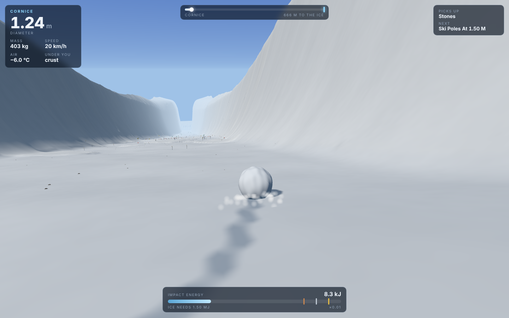
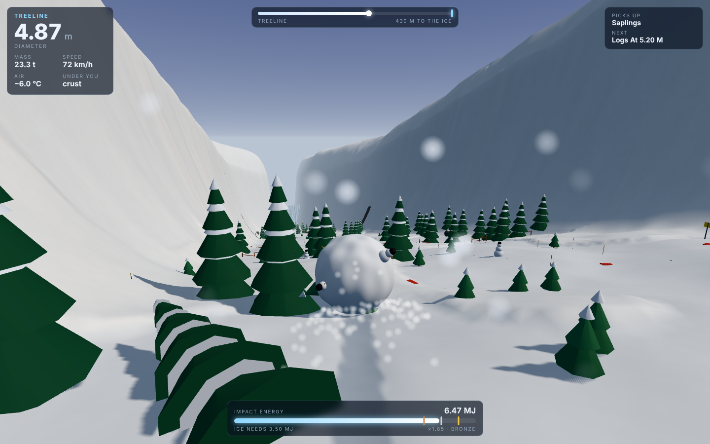
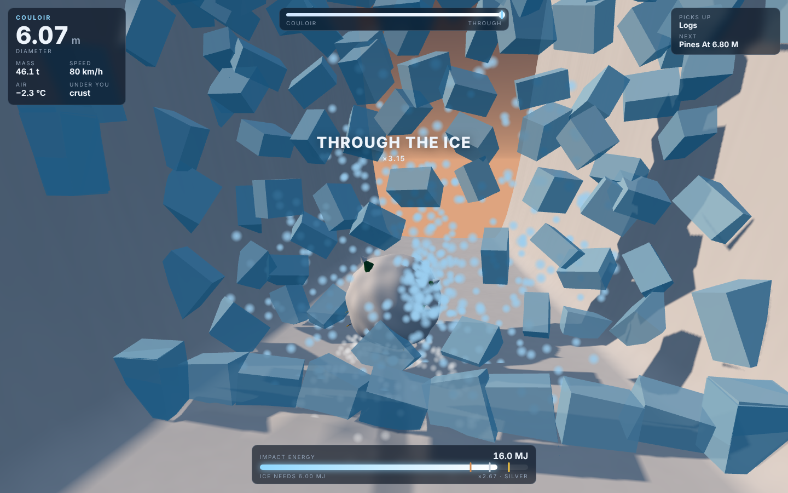
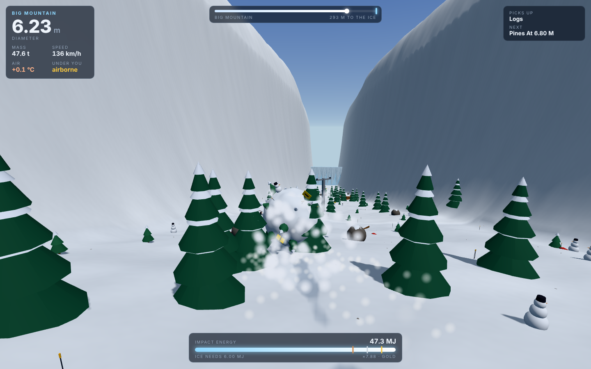
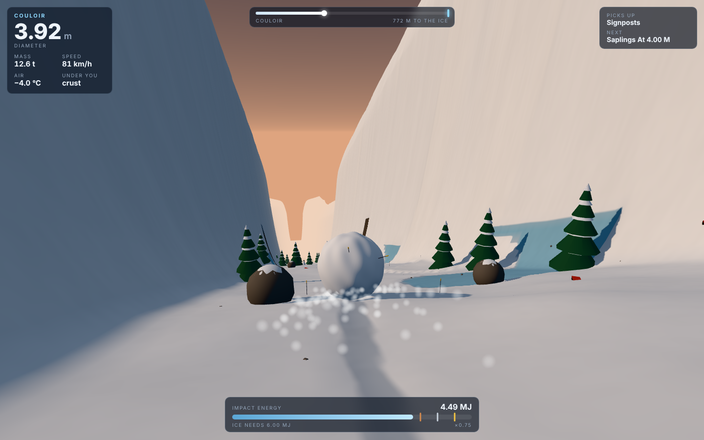
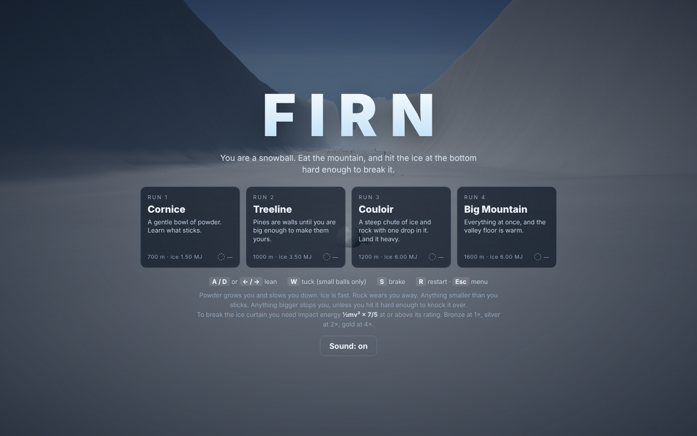
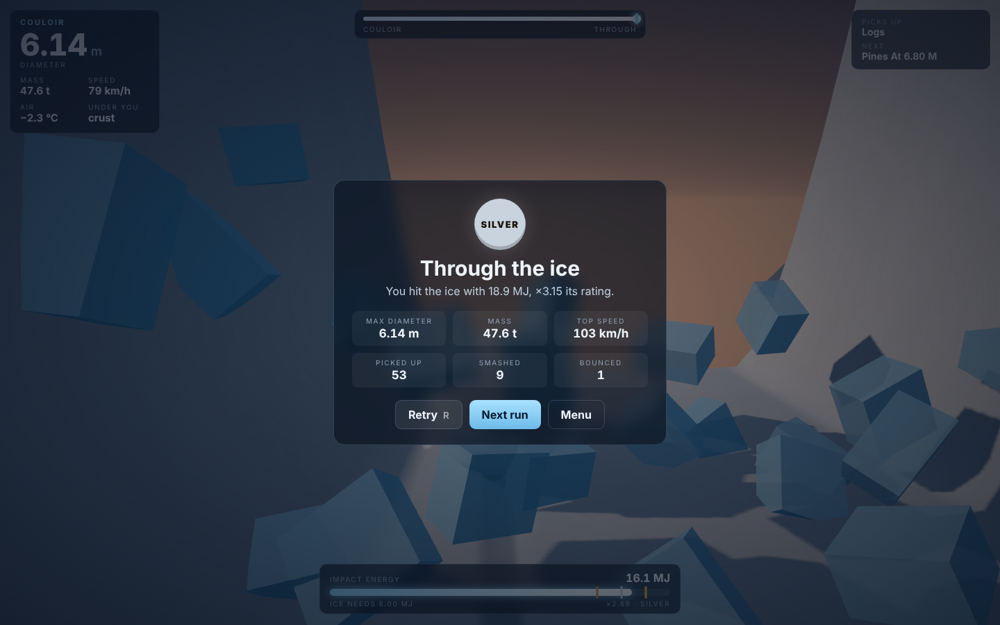
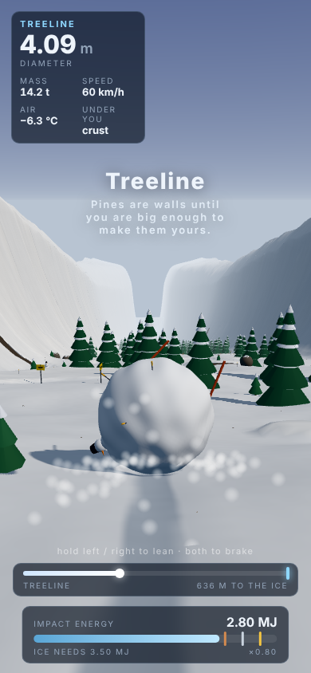

# Firn

**A 3D downhill snowball game.** You start as a fistful of snow on a cornice and
grow by eating the mountain. Anything smaller than you sticks to you, and
anything bigger stops you dead unless you hit it hard enough to knock it over.
At the bottom of every run a frozen waterfall closes the gully. It only breaks
if you reach it with enough impact energy, ½mv² × 7/5.

| Run 1: a 1.2 m ball cutting through powder | Run 2: the treeline, picking up saplings |
|:---:|:---:|
|  |  |

| Run 3: the ice curtain breaks | Run 4: 137 km/h with a ski-lift pylon ahead |
|:---:|:---:|
|  |  |

| Couloir, mid-run | Title | Result | Phone |
|:---:|:---:|:---:|:---:|
|  |  |  |  |

## The one idea

Everything you gain costs you something.

- **Snow costs speed.** Snow lying on the slope is standing still, so taking on a
  mass `dm` dilutes your momentum, `v ← v · m / (m + dm)`. Deep powder grows you
  fast and brakes you hard. Ice is fast and grows you not at all. Rock wears you
  away.
- **Size costs steering.** Your lean authority falls as `1 / (1 + r / 1.2 m)`. A
  small ball darts about, and a big one carves wide arcs and runs over things.
- **The snowpack is finite.** The course is a 0.5 m grid of snow depth. Wherever the
  sphere's underside dips below the snow surface, that snow is removed and
  goes into you, multiplied by its stickiness. Your own track is bare, and the groove
  is real geometry: the depth texture drives the terrain's vertex shader.
- **Props change role as you grow.** Each of the 14 prop classes has an absorb
  radius, a mass and a break energy. A fence post blocks a 0.5 m ball, falls
  to a 2 m ball moving fast, and sticks to a 2.4 m one. The HUD always shows the
  largest class you can pick up and the diameter you need for the next.

A rolling solid sphere accelerates at 5/7 g sin θ. Air drag falls as 1/r per unit
mass, so big balls run faster. The air warms by 6.5 °C per km of descent. Above
0 °C snow sticks better but you start to melt. Hard landings and hard bounces
knock snow off you.

## Runs

| # | Run | Length | Ice rating | Character |
|---|---|---|---|---|
| 1 | Cornice | 700 m | 1.5 MJ | Gentle bowl of powder, small props, a fence line |
| 2 | Treeline | 1000 m | 3.5 MJ | Pine forest, huts, two rock bands |
| 3 | Couloir | 1200 m | 6 MJ | Steep and narrow, ice sheets, three rock bands, a 9 m drop |
| 4 | Big Mountain | 1600 m | 6 MJ | Wide, a cliff, lift pylons, and a slush valley that brakes and melts you |

Medals: bronze at 1× the rating, silver at 2×, gold at 4×. Runs unlock in order and
your best ratio is saved in `localStorage`.

## Controls

| Input | Action |
|---|---|
| A / D or ← / → | lean |
| W / ↑ | tuck (only matters while you are small) |
| S / ↓ | brake |
| R / Esc | restart / menu |
| Touch | hold the left or right half to lean, and both halves to brake |

## Run it

```bash
cd showcase/apps/firn
python3 -m http.server 8080
# open http://localhost:8080
```

There's no build step. Three.js r163 is vendored in `vendor/`.

## Bench

```bash
node scripts/bench.mjs
```

The simulation in `src/sim.js` has no DOM or Three.js, so it runs headless. The bench checks:

- rolling acceleration on a uniform 15° incline matches 5/7 g sin θ, less rolling
  resistance and drag (1.6939 vs 1.6939 m/s²)
- steering authority falls monotonically with radius
- on every run, the mass ledger (initial + stuck snow + props − shed − melted)
  closes to the ball's mass, and the snow removed from the field equals stuck plus
  sprayed snow, both to ~1e-14
- the greedy bot in `src/bot.js` breaks the ice on all four runs
- rolling straight down Couloir hands-off does **not** earn gold

```
PASS  Cornice: bot breaks the ice  — broke, ×4.90 gold, Ø 5.7 m, 67 s, 80 picked up
PASS  Treeline: bot breaks the ice  — broke, ×4.53 gold, Ø 6.0 m, 76 s, 93 picked up, 8 smashed
PASS  Couloir: bot breaks the ice  — broke, ×3.15 silver, Ø 6.1 m, 78 s, 53 picked up, 9 smashed
PASS  Big Mountain: bot breaks the ice  — broke, ×1.52 bronze, Ø 8.9 m, 108 s, 127 picked up, 18 smashed
PASS  Couloir: hands-off straight line is not gold  — broke, ×1.79 vs bot ×3.15
16 passed, 0 failed
```

`node scripts/screens.mjs`, run with the folder served on `:8093`, regenerates the screenshots.

## Files

```
src/sim.js      terrain + snowpack generator, ball physics, props, ice curtain (pure JS)
src/levels.js   parameters for the four runs
src/bot.js      greedy line-picker (title-screen demo + bench)
src/scene.js    Three.js: displaced terrain shader, instanced props, particles, chase camera
src/audio.js    synthesised Web Audio: roll, wind, pops, thuds, shattering ice
src/hud.js      HUD, toasts, formatting
src/main.js     fixed 120 Hz loop, input, menus, saves
PRD.md          design document
```
