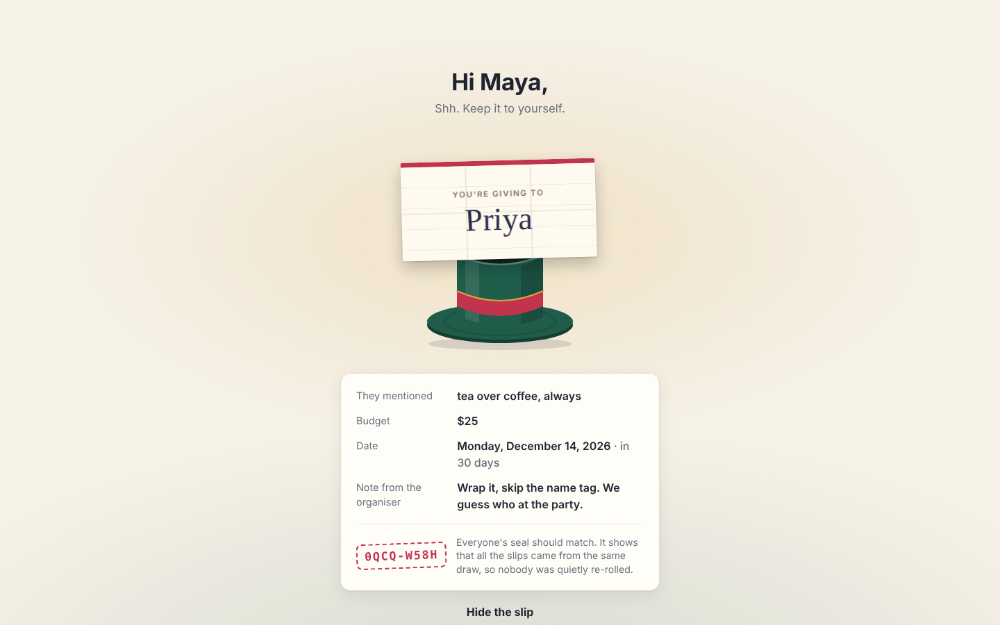
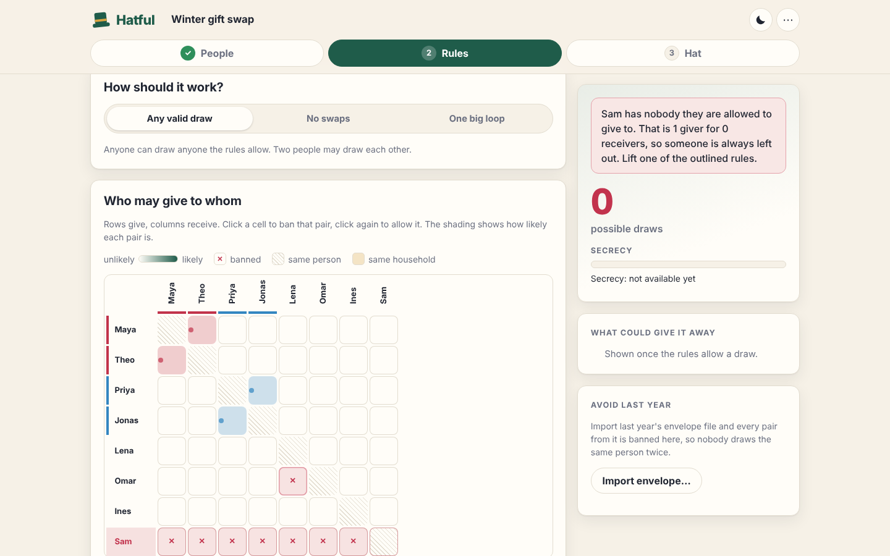
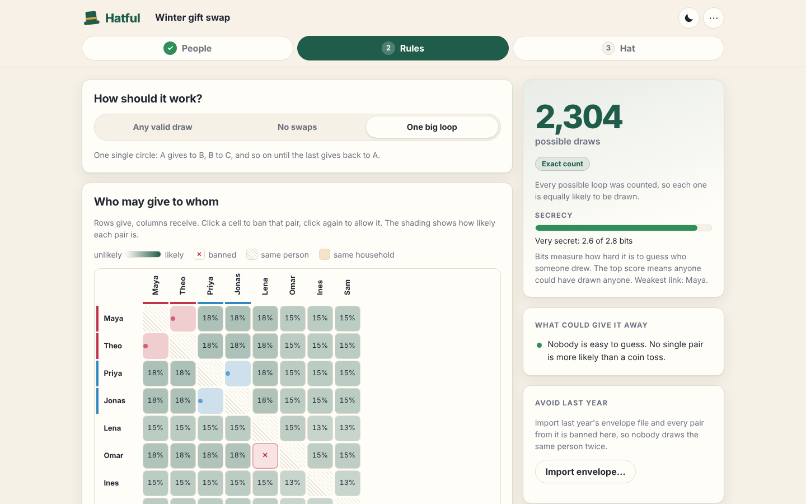
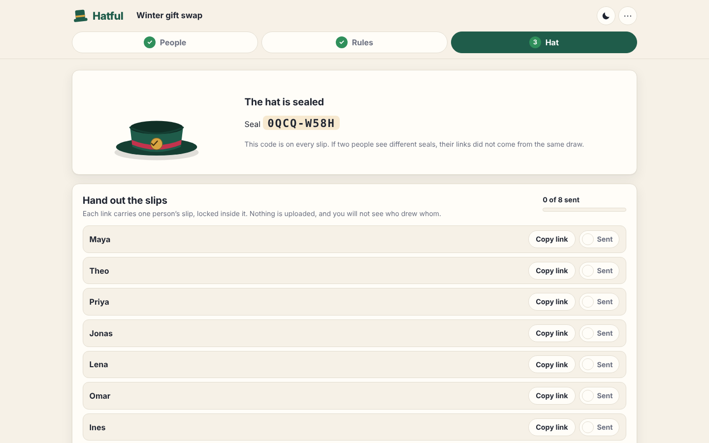
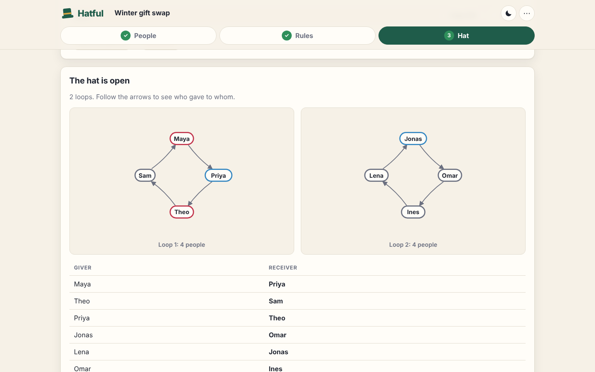
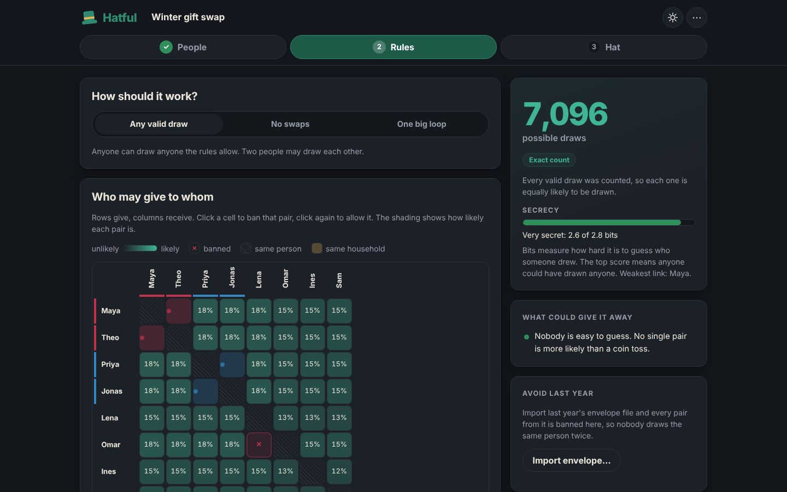
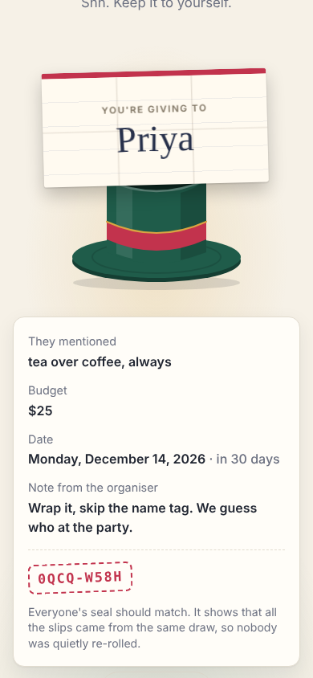

# Hatful

**Draw names for a Secret Santa, a gift swap or a book exchange, and see for
yourself that the draw is fair.** Add people, mark who lives together, ban a few
pairs, and Hatful counts every draw your rules allow and picks one of them
uniformly at random. Before you draw it shows the exact chance of each person
drawing each other person, so you can see when your rules give the secret away.
Each person then gets their own link with their slip encrypted inside it. There
is no server and no account.

| Rules: 7,096 possible draws, and the chance of every pair | A participant pulls their slip |
|:---:|:---:|
|  |  |

| Impossible rules, explained | One big loop mode | Hand out the links |
|:---:|:---:|:---:|
|  |  |  |

| The hat opened after the party | Dark mode | Phone |
|:---:|:---:|:---:|
|  |  |  |

## Run it

```bash
cd showcase/apps/hatful
python3 -m http.server 8080
# open http://localhost:8080
```

No dependencies and no build step. The first run opens a demo group of eight
with two couples and one ban. Links only work over `http://localhost` or
`https://`, because the browser's crypto API needs a secure context.

## How to use it

1. **People.** Names, an optional household (people in one household never draw
   each other) and an optional hint that is shown to whoever draws them.
2. **Rules.** Click a cell of the grid to ban that giver from drawing that
   receiver. Pick a mode: any valid draw, no swaps (nobody draws the person who
   drew them), or one big loop through everyone.
3. **Hat.** Draw, then copy or share each person's link, or pass one phone round
   the room (hold to see your name, release to hide it). You never see who drew
   whom unless you choose to open the hat.
4. **After the party.** Open the hat to see the loops, export the envelope file,
   and next year import it under *Avoid last year* to ban this year's pairs.

## How the draw works

- **Counting.** Givers are taken in order; `f[mask]` is the number of ways the
  first few givers can use exactly the receivers in `mask`, and `b[mask]` is the
  number of ways the rest can fill what is left. That is 2ⁿ entries, exact in a
  `Float64Array` up to 18 people (18! < 2⁵³).
- **Uniform sampling.** Walk the givers and pick receiver `j` with probability
  `b[mask | j] / b[mask]`. Every valid draw comes out with the same probability.
- **Pair chances.** `P(i gives to j)` is a sum of `f[mask] · b[mask | j]`
  divided by the total, so the whole grid costs one pass.
- **One big loop** counts Hamiltonian cycles with Held–Karp, exact up to 16.
- **No swaps** samples uniformly and rejects draws with a two-person swap, which
  stays uniform over what is left. Its count is an estimate and is labelled so.
- **Bigger groups** (19 to 22) use the same tables in floating point; above 22
  the draw is by rejection from random permutations, with a Markov chain as a
  last resort. The page says which method was used and warns if a draw was not
  exactly uniform.
- **Impossible rules.** When no draw exists, Hatful finds a Hall violator from
  a maximum matching: a set of givers who between them are allowed fewer
  receivers than there are givers, and names them.
- **Secrecy.** The score is the lowest entropy, in bits, of any one person's
  row of chances. Pairs at 50% or more are listed as likely leaks.

## Links, PINs and the seal

- A link is `reveal.html#<ticket>`. The ticket is the slip encrypted with
  AES-GCM. The part after `#` is never sent to a server.
- Without a PIN the key travels in the link. That keeps the name out of link
  previews and plain base64, but anyone holding the link can open it. With PINs
  on, the key is derived from a 4-digit PIN (PBKDF2, 120,000 rounds) that you
  send separately.
- The **seal** is a short hash of the people, rules, seed and result. It is on
  every slip, so two people can check they were part of the same draw.
- The **envelope** is a JSON export. *Verify* re-runs the draw from its seed and
  recomputes the seal.

### What it does not protect against

The organiser's browser makes the draw, so a determined organiser could read it
from local storage or the dev tools. Hatful keeps an honest organiser surprised;
it does not stop a dishonest one. A 4-digit PIN stops a casual look, not a
brute-force attempt by someone who has the link.

## Bench

```bash
node scripts/bench.mjs
```

29 checks, exit code 1 on any failure. Counts and pair chances against brute
force on 300 random rule sets; unrestricted counts against derangement numbers
to n = 18; a χ² uniformity test over 200,000 draws that the sampler passes and
a naive "first allowed name left" sampler fails (χ² 30 against 91,984); loop
and no-swap modes; Hall violators on 200 impossible rule sets; the sampled tier
at 26 people; determinism; ticket, PIN, seal and envelope round trips.

## Files

| Path | What |
|---|---|
| `index.html`, `style.css`, `src/app.js`, `src/ui/` | organiser page |
| `reveal.html`, `reveal.css`, `src/reveal.js` | participant page |
| `src/engine.js` | `analyse`, `draw`, `cyclesOf`, `isValid` |
| `src/count.js`, `src/loop.js`, `src/hall.js`, `src/sampled.js` | counting, loops, Hall violator, large groups |
| `src/links.js`, `src/seal.js`, `src/rng.js` | tickets and envelopes, seal, seeded RNG |
| `scripts/bench.mjs`, `scripts/screens.mjs` | bench, screenshots |
| `PRD.md` | research, scope and build plan |

Query flags: `?demo`, `?step=people|rules|hat`, `?theme=dark|light`; on the
reveal page `?auto=1` pulls the slip without a tap.

## Deploy

Static. As its own Vercel project set **Root Directory** to
`showcase/apps/hatful`; no build command and no environment variables. To check
a deploy, open `/reveal.html` with no hash: it should show the explainer page.

Limits: 3 to 30 people. Not tested outside Chromium.
