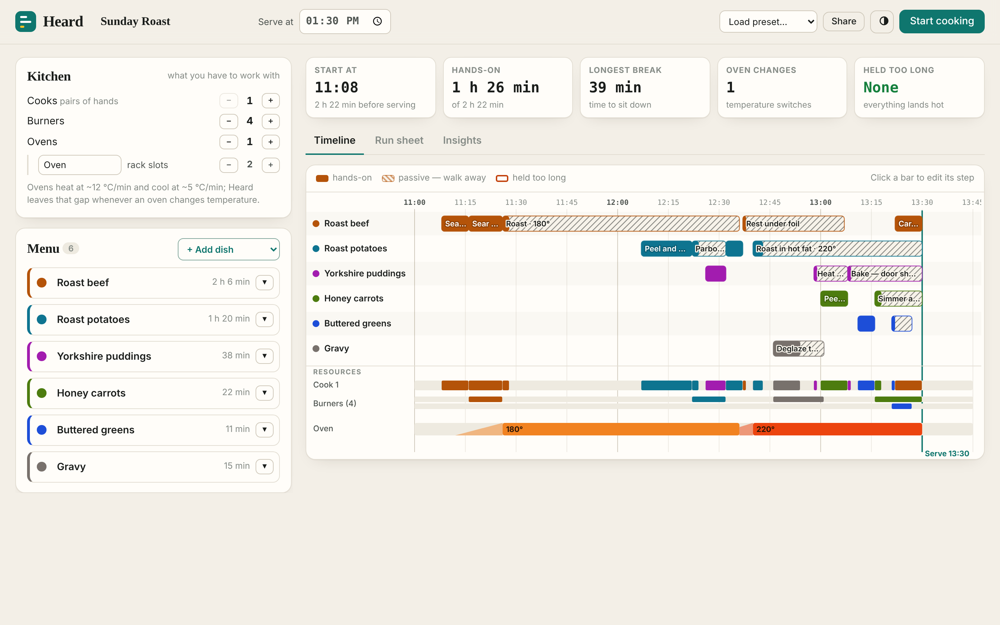
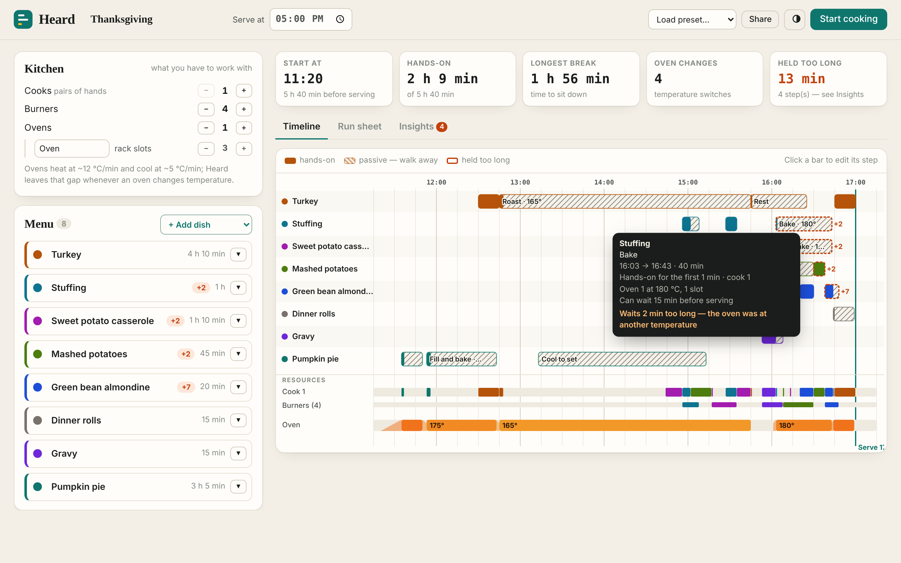
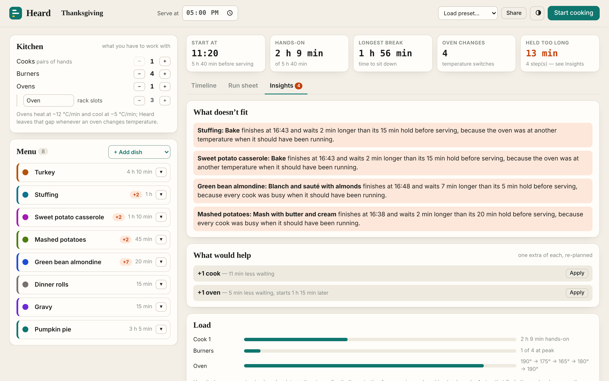
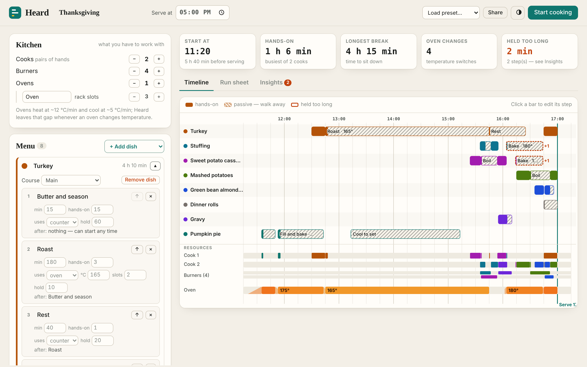
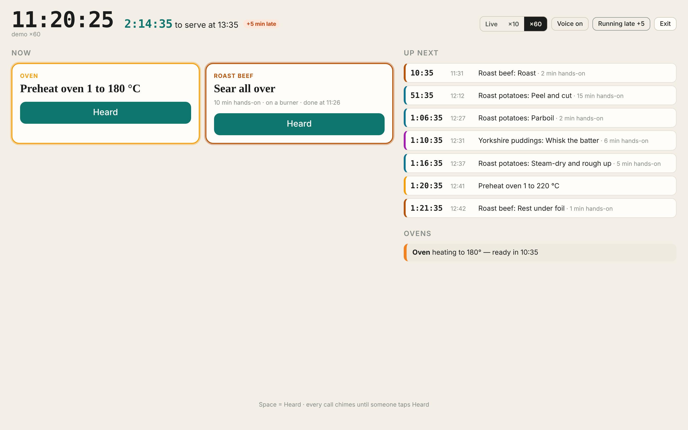
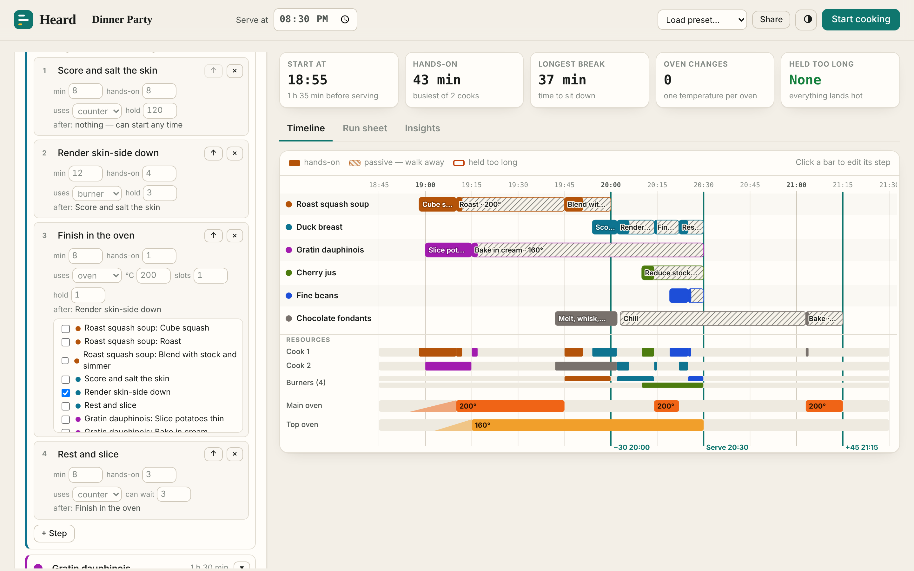
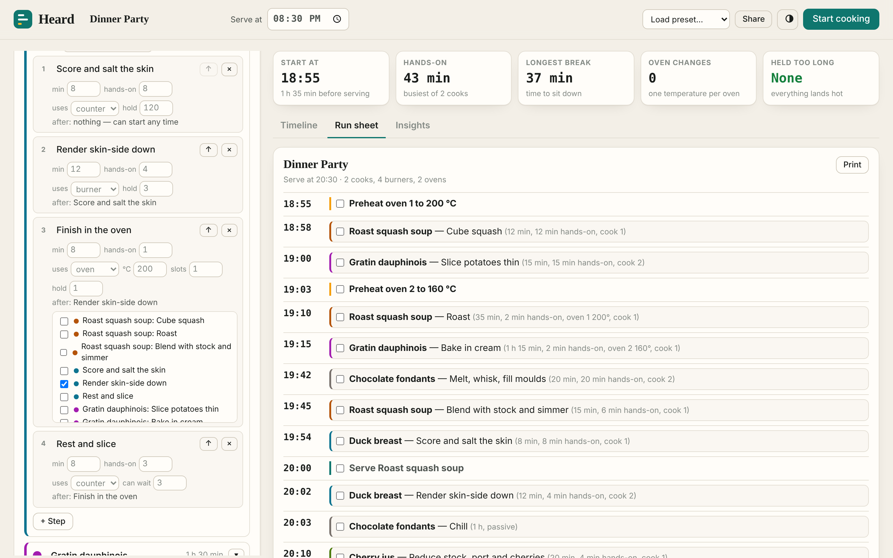
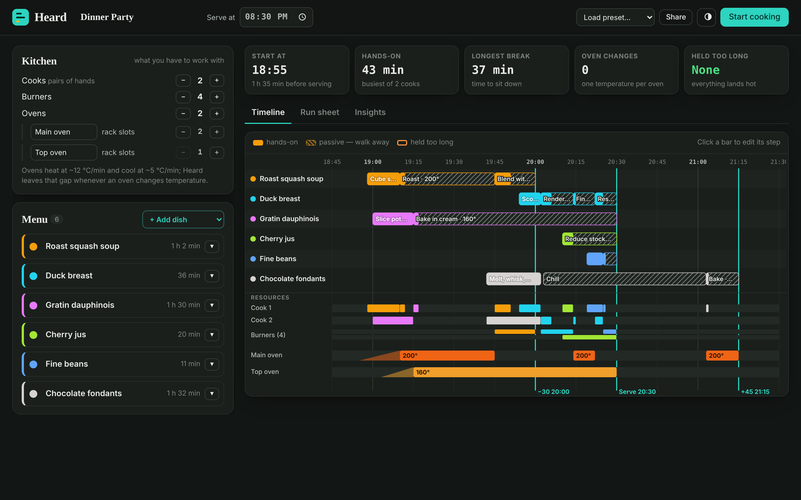
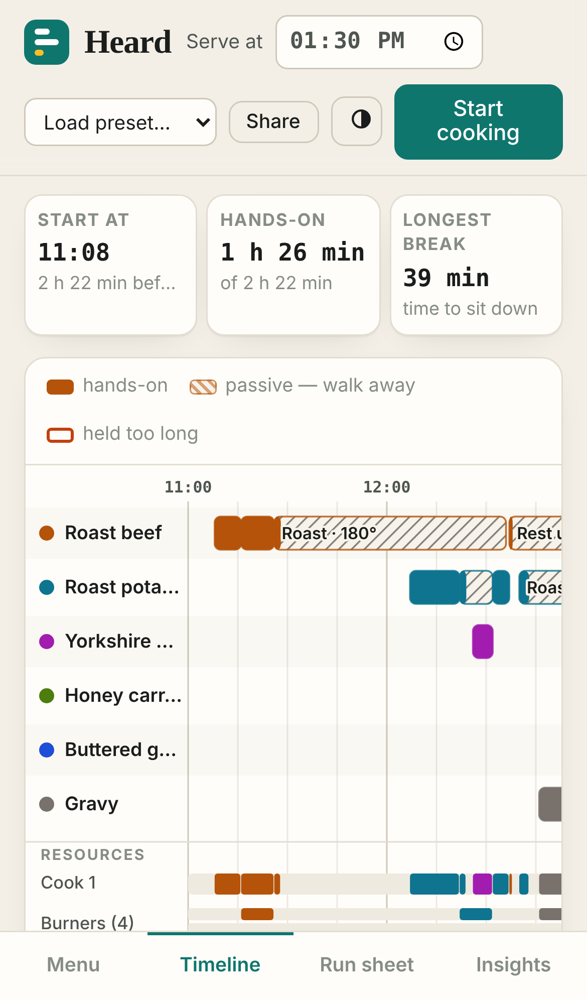

# Heard

**Plan a whole meal backwards from serving time, then cook it with live calls.**
Tell Heard what you're cooking, what your kitchen has (cooks, burners, ovens and
rack space) and when you want to eat. It schedules every step as late as it can
while never asking for two things at once from one pair of hands, putting more
pans on than you have burners, or running one oven at two temperatures. It also
leaves time for the oven to heat up or cool down between temperatures. When a
step has to wait longer than it should, Heard says which step, by how much, and
why. It then re-plans with one more cook, burner, oven or rack slot to show what
would help. Cook mode chimes and speaks each step as it comes due, and someone
taps **Heard** to acknowledge it, as on a restaurant line.

| Sunday Roast: beef at 180 °C, then the oven climbs to 220 °C while it rests | Thanksgiving on one oven: the bottleneck, explained |
|:---:|:---:|
|  |  |

| Insights: what doesn't fit and what would help | After applying "+1 cook" | Cook mode |
|:---:|:---:|:---:|
|  |  |  |

| Step editor with cross-dish dependencies | Printable run sheet | Dark | Phone |
|:---:|:---:|:---:|:---:|
|  |  |  |  |

## Run it

```bash
cd showcase/apps/heard
python3 -m http.server 8080
# open http://localhost:8080
```

No dependencies and no build step. It opens with a Sunday Roast; four presets
are in the top bar (Sunday Roast, Thanksgiving, Weeknight Pasta, Dinner Party).
Shortcuts: **C** start cooking, **1/2/3** switch tabs, **Space** = Heard in cook mode.

## The model

| Thing | Fields |
|---|---|
| Kitchen | cooks (1–4), burners (0–8), ovens (0–3) each with rack slots |
| Dish | name, colour, course offset (starter −30, main 0, dessert +45, or custom) |
| Step | minutes, hands-on minutes *at the start*, uses (counter / burner / oven at °C with slots), hold, after |

- **Hands-on** is the attention a step needs from a cook, counted from its start.
  The rest of the step is passive (hatched on the timeline): walk away.
- **Hold** is how long the step's result can wait for the next step. On a dish's
  last step it is how long the dish can wait before its course is served. Pasta
  holds for 1–2 minutes, a resting roast for 15.
- **After** defaults to the previous step in the same dish. You can point it at
  any step in any dish, e.g. the gravy starts once the roast leaves the oven.
- **Ovens** heat at about 12 °C/min and cool at about 5 °C/min with the door shut.
  Switching an oven between temperatures needs that much idle time.

## How it plans

A reverse serial schedule-generation scheme on a one-minute grid:

1. Time runs backwards from serving (t = 0). A step is *eligible* once every step
   that depends on it has been placed.
2. The eligible step with the highest priority goes next. Priority is its latest
   allowed finish, minus a weight on its hold (tight steps first), plus random
   terms that vary from run to run.
3. It is placed to finish as late as possible: at its course time, or when its
   earliest successor starts. It slides earlier only when a cook, a burner, oven
   slots, the oven's temperature or the preheat/cool gap to a neighbouring
   temperature block isn't available. If it slides past its hold window, the
   overrun is recorded together with the resource that pushed it.
4. **Repair.** If a step ran late only because its successor sat as late as it
   could, the successor is pulled earlier within its own slack and the pass re-runs
   (up to four times). This lets a pie cool all afternoon so that its bake happens
   before the turkey occupies the oven.
5. 120 priority orderings (seeded, so the same menu always gives the same plan)
   are scored: hold violations × 1000 + span × 3 + distance from the course time
   + oven temperature changes × 6. The best one wins.

Steps the kitchen cannot do at all (an oven step with no oven, more slots than any
oven has) are flagged and drawn without the resource rather than silently dropped.
Dependency cycles from bad edits are broken, not looped on.

**What would help** re-plans with +1 cook, +1 burner, +1 oven and +1 rack slot.
It lists only the changes that cut waiting or let you start later.

## Cook mode

- A big clock, minutes to serving, **Now** cards (new calls pulse until someone
  taps *Heard*; running steps show a countdown and whether they still need your
  hands), an **Up next** queue and live oven status.
- Every call chimes (Web Audio) and is spoken (speechSynthesis; toggle *Voice*).
  An unacknowledged call re-chimes every 30 s.
- **Running late +5** pushes back everything that hasn't started yet, including
  serving.
- Screen wake lock where supported. **×10 / ×60** demo clocks; if the first call
  is hours away you're offered the demo or "start now, eat later", which moves
  the serve time.

## Sharing and storage

The menu autosaves to `localStorage` (and keeps working in memory if storage is
blocked). **Share** copies a link whose `#m=` hash holds the whole menu and
kitchen, deflate-compressed with `CompressionStream`. No server is involved.

## Bench

```bash
node scripts/bench.mjs
```

31 checks. An independent audit rebuilds every cook, burner and oven timeline
from the plan's items and checks precedence, capacity, one temperature per oven,
the heat/cool gap between temperatures, that no course is late and that reported
lateness is correct. This runs on every preset and on 60 random menus, including
a 40-step one, which must plan in under 300 ms. The bench also checks:

- the plan is deterministic;
- every "what would help" suggestion really improves the plan;
- Sunday Roast fits with no holds broken and runs the oven 180 → 220 °C while the
  beef rests;
- Thanksgiving names its bottleneck and a fix;
- cycles and impossible steps are handled;
- the share codec round-trips.

`scripts/screens.mjs` regenerates the screenshots, clicking through Apply,
Heard and Running late on the way.

## Files

```
index.html        shell
style.css         light/dark theme, phone layout, print stylesheet for the run sheet
src/schedule.js   the planner, what-if, cues
src/presets.js    the four menus and the add-dish library
src/timeline.js   SVG Gantt with resource lanes and oven heat strips
src/editor.js     kitchen and menu editor
src/cook.js       live cook mode
src/codec.js      share-link codec
src/app.js        state, tabs, run sheet, insights
src/time.js, src/dom.js   helpers
PRD.md            product requirements
```
