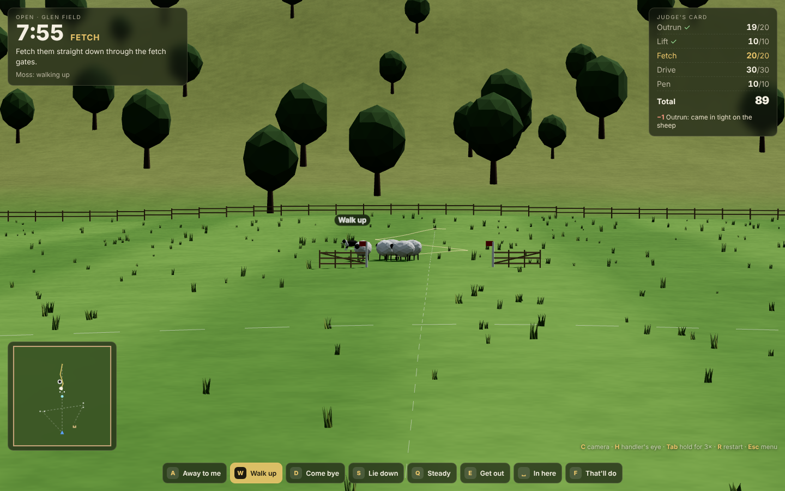
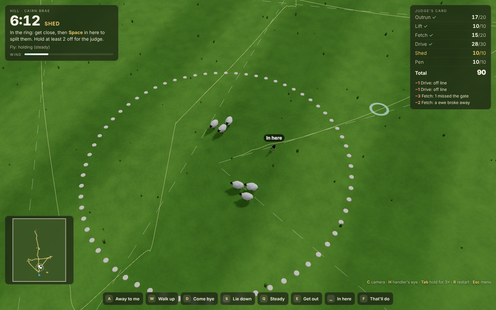
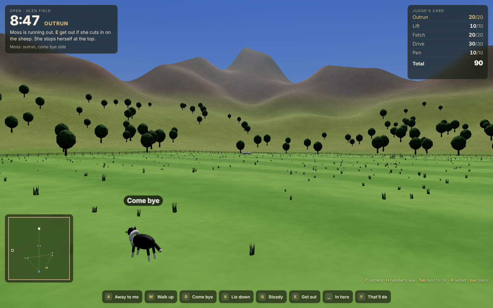
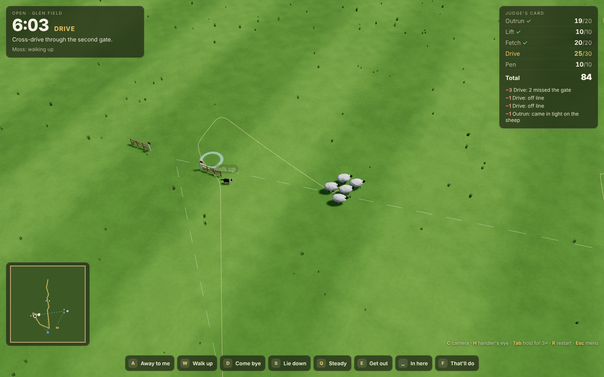
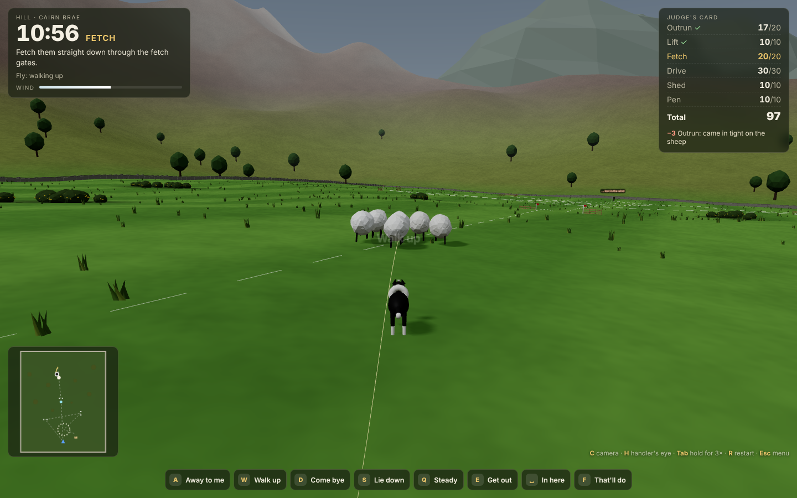
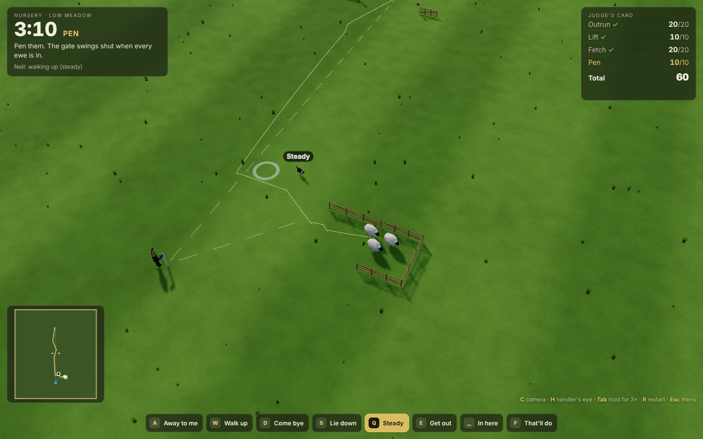
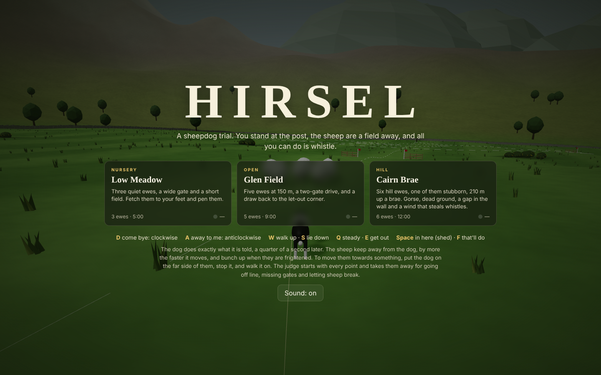
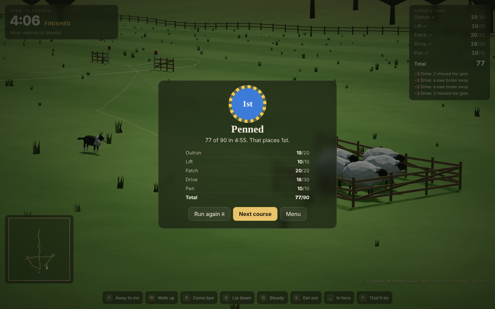
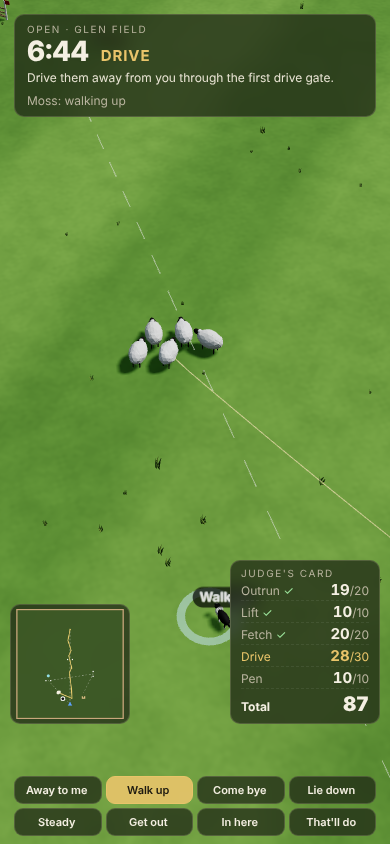

# Hirsel

**A 3D sheepdog trial in which you are the handler, not the dog.** You stand at
the post with a crook and a whistle, the sheep are 150 m up the field, and the
only thing you can do is whistle. The collie does exactly what she is told, a
quarter of a second later. The sheep do what sheep do. A judge starts with every
point and takes them off you for each metre off line, each missed gate and each
ewe that breaks.

*Hirsel* is Scots for a flock of sheep and the ground they graze.

| Fetch: through the gates, seen from the post | The shed: split and held in the ring |
|:---:|:---:|
|  |  |

| Outrun, with the dog | Cross-drive, judge's view | Hill fetch, gorse and wind | Pen |
|:---:|:---:|:---:|:---:|
|  |  |  |  |

| Title | Judge's card | Phone |
|:---:|:---:|:---:|
|  |  |  |

## How it plays

You can't move anything yourself. You have eight whistles:

| Key | Whistle | The dog |
|---|---|---|
| **D** | *Come bye* | flanks **clockwise** round the sheep, and keeps going until told otherwise |
| **A** | *Away to me* | flanks **anticlockwise** |
| **W** | *Walk up* | walks straight at the sheep, and stops short of them on her own |
| **S** | *Lie down* | stops dead and drops |
| **Q** | *Steady* | halves the speed of whatever she is doing |
| **E** | *Get out* | widens the flank or outrun by 6 m (up to three times) |
| **Space** | *In here* | in the shed: runs through the flock to split it, then holds the smaller group |
| **F** | *That'll do* | comes back to your feet |

The first flank whistle sends her on the outrun, and she stops herself at the
top, directly behind the sheep. From there it is one rule, applied over and over:
**put the dog on the far side of the sheep from where they should go, stop her,
and walk her on.** Every whistle is a distinct synthesised pitch contour, so you
can learn the commands by ear.

Other keys: **C** cycles the camera (from the post, the judge's view, or with
the dog), **H** toggles the handler's eye assist (the balance point, the judge's
line and the flock's trail), holding **Tab** runs time at 3×, the mouse wheel
zooms, **R** restarts and **Esc** returns to the menu. On a phone, the whistle bar
is a row of buttons.

## The sheep

There is no script. Each ewe steers towards a desired velocity built from a
handful of terms:

- **Flight zone.** Pressure from the dog is `p = 1 − d / fz`, with a personal `fz`
  of 12–22 m. A moving dog presses up to 45% harder than a still one. Flight speed
  is `vmax · p^0.75`, so a dog walking up at 2.2 m/s settles about 10 m behind
  sheep moving at her pace. Push in faster and they run.
- **Stress** rises fast with pressure, decays over about 4 s and spreads between
  neighbours. Stressed sheep bunch together (cohesion grows up to 13×) and move as
  one. Calm sheep spread out, amble and put their heads down to graze.
- **Breaking.** A stressed ewe with the dog deep in her flight zone can bolt
  sideways and towards the draw for a few seconds. That costs points and splits
  the flock.
- **The draw.** Sheep drift back towards the let-out corner, weakly on the flat and
  strongly on the hill, so a drive that ignores the draw curves.
- **A ewe won't walk past the dog to rejoin the others.** This is what makes the
  shed hold: once the dog is in the gap, cohesion across her is cancelled.
- **The wilful ewe** on Cairn Brae has courage. A creeping dog at *steady* barely
  shifts her, and she stamps. A firm walk-up moves her.

## The judge

| Phase | Points | Deductions |
|---|---|---|
| Outrun | 20 | coming in tight on the sheep, stopping, redirecting, being pushed out |
| Lift | 10 | sheep running, breaks, a slow lift |
| Fetch | 20 | off-line samples every 8 m (−1 beyond 6 m, −2 beyond 14 m), missed gate (−5, or −3 if only some sheep miss), breaks, a split flock |
| Drive | 30 | the same, over three legs and two gates |
| Shed | 10 | time beyond 45 s, ewes leaving the ring |
| Pen | 10 | time beyond 50 s, breaks from the pen mouth |

Phases you don't finish before the clock runs out score nothing. Placings:
**1st** at 85% of the available points, **2nd** at 70%, **3rd** at 55%.

## Courses

| # | Course | Ewes | Clock | Phases | Character |
|---|---|---|---|---|---|
| 1 | Low Meadow (nursery) | 3 | 5:00 | outrun, lift, fetch, pen | flat, calm sheep, a 9 m gate |
| 2 | Glen Field (open) | 5 | 9:00 | + drive | 150 m outrun, a two-gate drive, a draw to the let-out corner |
| 3 | Cairn Brae (hill) | 6 | 12:00 | + shed | a 210 m brae, dry-stone walls, gorse the dog has to push through, a wilful horned ewe, a strong draw and wind gusts that can carry a whistle away |

Courses unlock when you place on the one before. Best scores are kept in
`localStorage`.

## Run it

```bash
cd showcase/apps/hirsel
python3 -m http.server 8080
# open http://localhost:8080
```

There's no build step. Three.js r163 is vendored in `vendor/`, and all the
audio is synthesised.

## Bench

```bash
node scripts/bench.mjs
```

`src/sim.js` has no DOM or Three.js, so the whole trial runs headless. The
bench checks that:

- the same seed and the same whistles give an identical run
- a dog lying 40 m away leaves the sheep calm, and a walking dog moves them away
  from it
- *come bye* turns the dog clockwise as seen from above and *away* anticlockwise
- no sheep ever ends a step through a field fence or a pen hurdle
- the balance-point bot in `src/bot.js` pens and places on every course, and still
  places on at least five of six other seeds
- a careless handler who just walks the dog in scores far worse than the bot

```
PASS  Determinism: same seed, same run  — 77 pts at 294.55 s both times
PASS  Flight zone: a dog lying 40 m off leaves the sheep calm  — max stress 0.000
PASS  Flight zone: a dog walking up from the north pushes the flock south  — centroid moved 13.9 m away from the dog
PASS  Flank sense: come bye goes clockwise, away to me anticlockwise  — Δθ 0.43 / -0.45 rad
PASS  Low Meadow: no sheep through a fence or a hurdle  — every step clear
PASS  Low Meadow: the bot pens and places  — penned, 60/60 → 1st in 112 s, 44 whistles, 0 breaks
PASS  Glen Field: no sheep through a fence or a hurdle  — every step clear
PASS  Glen Field: the bot pens and places  — penned, 77/90 → 1st in 294 s, 62 whistles, 2 breaks
PASS  Cairn Brae: no sheep through a fence or a hurdle  — every step clear
PASS  Cairn Brae: the bot pens and places  — penned, 86/100 → 1st in 439 s, 115 whistles, 1 breaks
PASS  Low Meadow: the bot places on at least 5 of 6 other seeds  — Low Meadow 6/6
PASS  Glen Field: the bot places on at least 5 of 6 other seeds  — Glen Field 6/6
PASS  Cairn Brae: the bot places on at least 5 of 6 other seeds  — Cairn Brae 5/6
PASS  Handling matters: a careless handler scores worse on Glen Field  — careless 29 (time) vs bot 77
14 passed, 0 failed
```

To regenerate the screenshots, serve the folder on `:8094` and run
`node scripts/screens.mjs`.

## Files

```
src/sim.js      terrain, sheep, dog, judge (pure JS, fixed 60 Hz step)
src/courses.js  the three course layouts
src/bot.js      balance-point handler with pure-pursuit line keeping (title demo + bench)
src/scene.js    Three.js: terrain, walls, hurdles, pen, characters, cameras
src/audio.js    synthesised whistles, bleats, wind, skylarks
src/hud.js      status, judge's card, whistle bar, minimap
src/main.js     loop, input, menus, saves, screenshot hooks
PRD.md          design document
```
