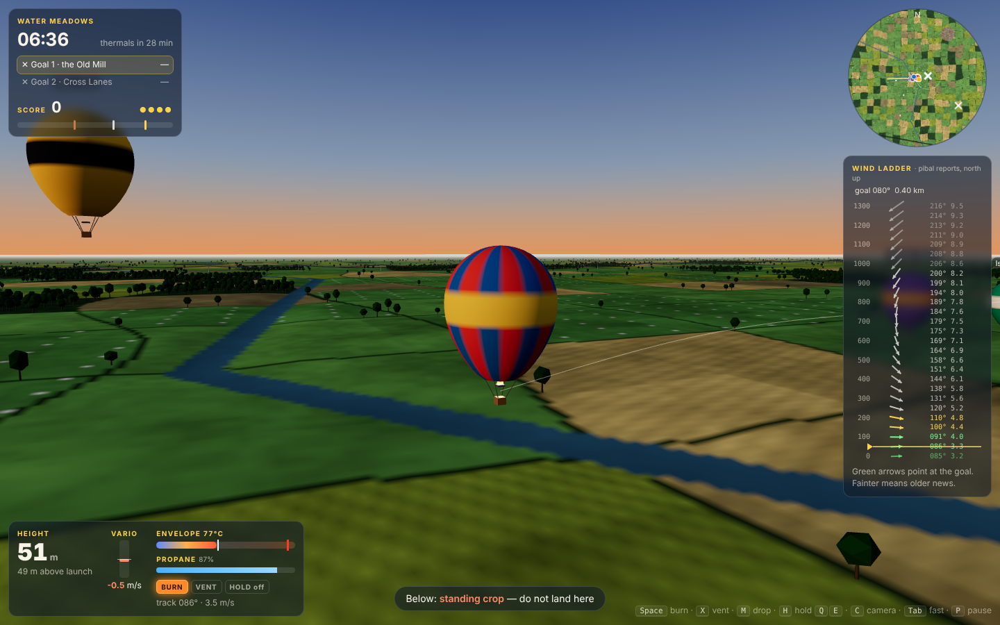
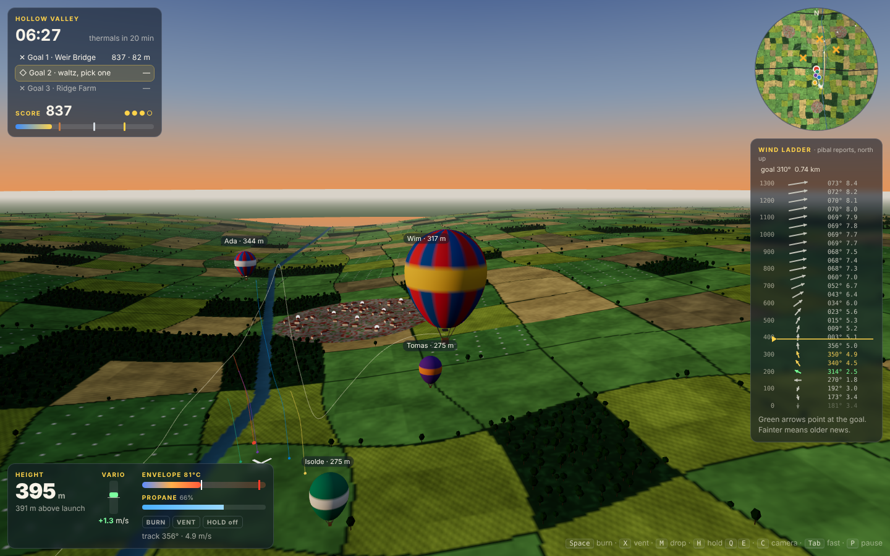
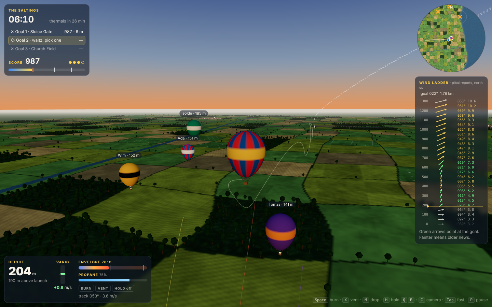
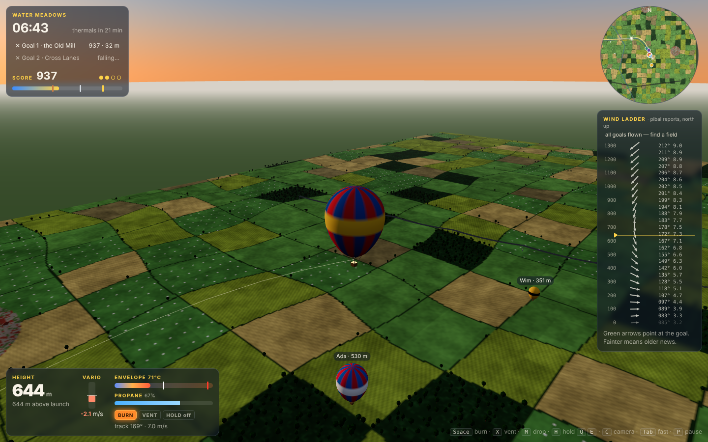
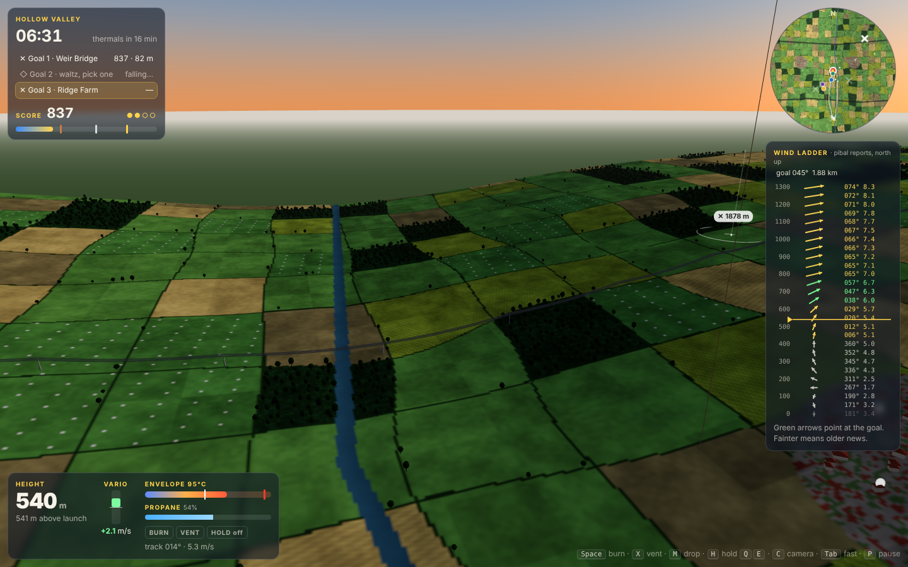
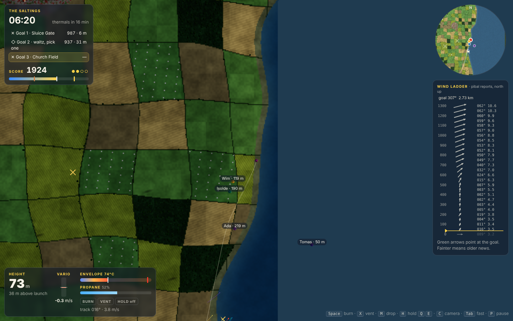
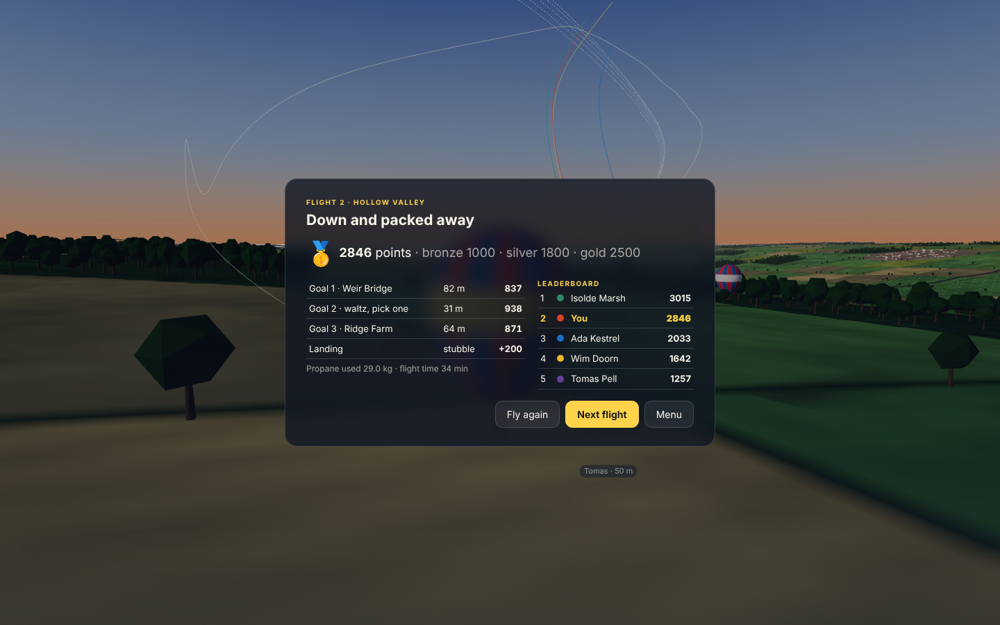
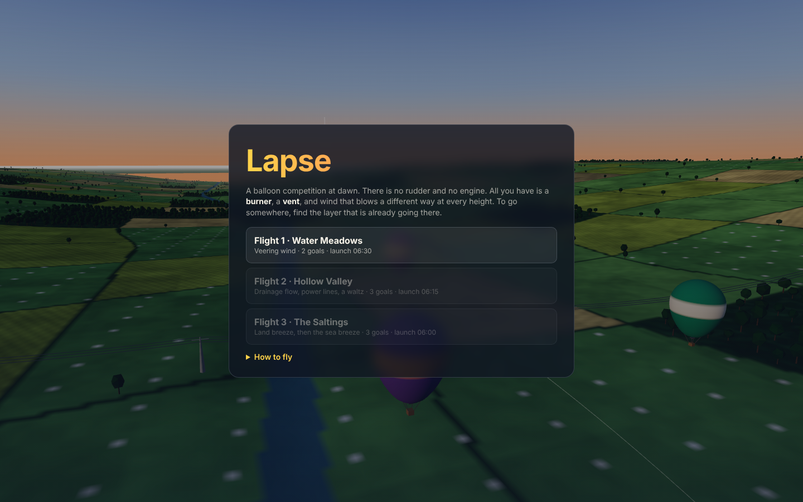
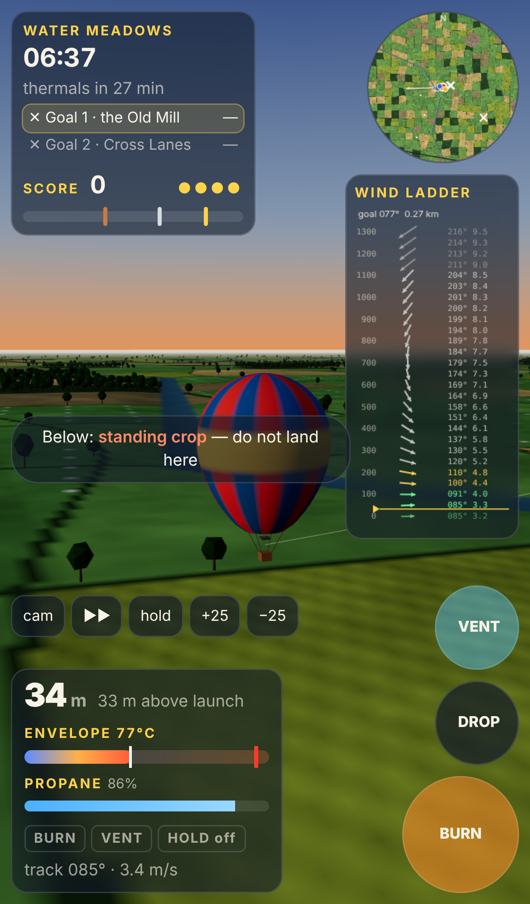

# Lapse

**A 3D hot-air balloon competition at dawn, with no rudder and no engine.**
You have a burner, a vent, and wind that blows a different way at every
height. To get somewhere, you find the layer that is already heading there,
climb or sink into it, and wait, because a balloon is several tonnes of air
and nothing happens quickly. Over each fabric cross you throw a marker that
drifts in every layer on its way down. Then you land in a farmer's field
before the sun starts the thermals.

| Over the Water Meadows | Hollow Valley, the drainage flow |
|:---:|:---:|
|  |  |

| The Saltings, five balloons | A marker falling to goal 2 | From the basket |
|:---:|:---:|:---:|
|  |  |  |

| Map camera at the coast | End of flight | Title | Phone |
|:---:|:---:|:---:|:---:|
|  |  |  |  |

## Run it

```bash
cd showcase/apps/lapse
python3 -m http.server 8080
# open http://localhost:8080
```

No build step and no network. Three.js is vendored in `vendor/`.

## How to fly

| Input | Action |
|---|---|
| **Space** (hold) | Burner. The envelope heats at about 1.2 °C/s and you rise roughly half a minute later |
| **X** / **Shift** (hold) | Vent: spill hot air |
| **M** | Throw a marker for the current goal |
| **H**, then **Q** / **E** | Altitude hold (assist), and move the set height ±25 m |
| **C** | Camera: chase, basket, map |
| Drag / wheel | Orbit / zoom |
| **Tab** (hold) / **F** | Fast-forward ×4 (the sim normally runs at ×2) |
| **G** | Marker aid on/off (the yellow ring showing where a marker would land) |
| **K** | Give up the current goal |
| **L** | Deflate once you are on the ground |
| **P** / **Esc** | Pause |

Phones get BURN / VENT / DROP buttons plus camera, fast-forward and hold.

**Reading the sky.** The **wind ladder** on the right shows the wind every
50 m up to 1,300 m, with arrows pointing the way the air is going, north up.
Arrows that point at the current goal are green, and ones within 40° are
amber. A sounding is taken at launch, and every 100 s another pibal (a small
white balloon) is released from the launch field and overwrites each band as
it rises through it. Fainter rows are older news. The ladder only describes
the air over the launch field, though. Four kilometres away the wind has
wandered, and chimney smoke and the four rival balloons (labelled with their
heights) are your evidence there.

**Scoring.** A goal is worth `1000 × (1 − d / 500 m)`, where d is the
marker's distance from the centre of the cross. A ◇ hesitation waltz scores
whichever of its crosses you land nearest. Landing scores +200 in pasture,
stubble or fallow. Penalties: −100 for each touchdown in a bad field, −150
for a hard landing (more than 3.5 m/s down), −300 for coming to rest in crops,
livestock, woods or a village, −500 in water, −400 for still flying at the
deadline, and −50 per second with the envelope above 120 °C. Hitting a power
line scores zero for the flight.

## The flights

| Flight | Launch | Thermals / deadline | What it teaches |
|---|---|---|---|
| **Water Meadows** | 06:30 | +34 / +42 min | A textbook veering profile. The low air goes east-north-east, and the higher you go the further it swings south. Two goals. |
| **Hollow Valley** | 06:15 | +32 / +40 min | Cold air drains down the valley floor below ~120 m, with a return flow above it. A power line crosses the valley between you and goal 1. From 15 minutes in, the drainage dies away. Goal 2 is a three-cross waltz. |
| **The Saltings** | 06:00 | +36 / +44 min | A coast. At dawn the low air is a land breeze heading out to sea. From 18 minutes the sea breeze ramps in over five minutes and reverses the bottom 250 m, which is the only way to reach goal 3 inland. |

A bronze medal unlocks the next flight.

## The model (`src/sim.js`, `src/world.js`)

- **Atmosphere:** ISA pressure `p = 101325 (1 − 2.25577e-5 h)^5.25588`.
  Temperature is the flight's surface value plus a dawn **inversion** (warmer
  with height up to its top, 140–220 m), then −6.5 K/km.
- **Balloon:** V = 2,600 m³ and m = 580 kg dry plus 40 kg of propane. Lift
  is `(ρ_air − ρ_env)·V·g`, with `ρ = p / (R·T)` inside and out, so the float
  temperature over a 9 °C morning is about 76 °C, and the redline is 120 °C.
- **Inertia:** the moving mass is the balloon plus the hot air inside it plus
  half the displaced air (added mass), about 4.7 t. Vertical drag is
  `½ρ·0.8·227 m²·v|v|`, measured relative to any rising air.
- **Heat:** the burner gives 2.6 MW to the envelope air and burns 0.093 kg/s.
  The fabric loses `(4 + 0.8·airspeed) W/m²K × 950 m²`, and the vent spills
  up to 3.5% of the temperature excess per second.
- **Horizontal:** quadratic drag towards the local wind on the whole moving
  mass, so picking up a new layer takes about 30 s.
- **Wind:** keypoint layers by height (direction interpolated on the
  shortest arc) × slow value-noise wander in space and time (±14°, ±14%) ×
  ground friction in the bottom 30 m, plus per-flight evolution (the valley's
  drainage dying, the sea breeze arriving) and, after thermal onset, drifting
  bubbles of rising air of up to ~4.5 m/s.
- **Markers:** 70 g with an 8 m/s terminal fall, picking up each layer's wind
  with a 1.5 s lag. The same integrator drives the aid ring and the bot.
- **Fields:** a noise-warped 260 m grid, assigned from a seeded hash, with
  woods on steep slopes and water from the river and the coast. The ground
  texture is painted pixel by pixel from the same `fieldAt()` that decides
  whether a landing is legal.

## The rivals (`src/bot.js`)

All four rivals and the menu demo use one planner. Every 6–18 s it tries 36
target heights from 30 to 1,100 m. For each one it simulates eight-second
steps through the true wind field for six minutes, climbing at 1.8 m/s and
adding the drift a marker would pick up if thrown from there, and it keeps
the height with the best closest approach to the goal after costs for
changing height and for time. It throws when the predicted landing point
stops improving and its own plan says nothing better is coming. To land, it
looks where the low wind will carry it during the descent and only commits
if that is a legal field away from wires. Skill levels add cost noise, a
fixed bias in how they read the wind (6–20°), slower re-planning and sloppier
throws.

## Bench

```bash
cd showcase/apps/lapse
node scripts/bench.mjs
```

Twelve headless checks: determinism, float temperature (75.8 °C, lift = mass
to 1e-6 kg), burner lag (lift-off 9 s into a burn, peak climb 2.5 m/s), the
propane ledger, a hands-off pilot scoring 0, a marker landing within 0.1 m of
the predictor and 3 m of the hand-integrated wind drift, a power-line strike
zeroing the flight, the pibal ladder matching the field, the expert bot taking
gold on all three flights (1988 / 2846 / 3084) and landing legally, and the
expert beating a rough rival on every flight.

`node scripts/screens.mjs` regenerates the screenshots, with the folder served
on :8097.

## Files

```
index.html  style.css
src/world.js   flights, terrain, fields, atmosphere, wind field, power lines
src/sim.js     balloon physics, markers, pibals, scoring
src/bot.js     the layer planner (rivals, demo, bench)
src/scene.js   Three.js world: painted terrain, trees, villages, smoke, pylons, balloons
src/hud.js     wind ladder, minimap, instruments
src/audio.js   synthesised burner roar and cues
src/main.js    loop, input, menu, results
scripts/       bench.mjs, screens.mjs
vendor/        three.module.js
```
