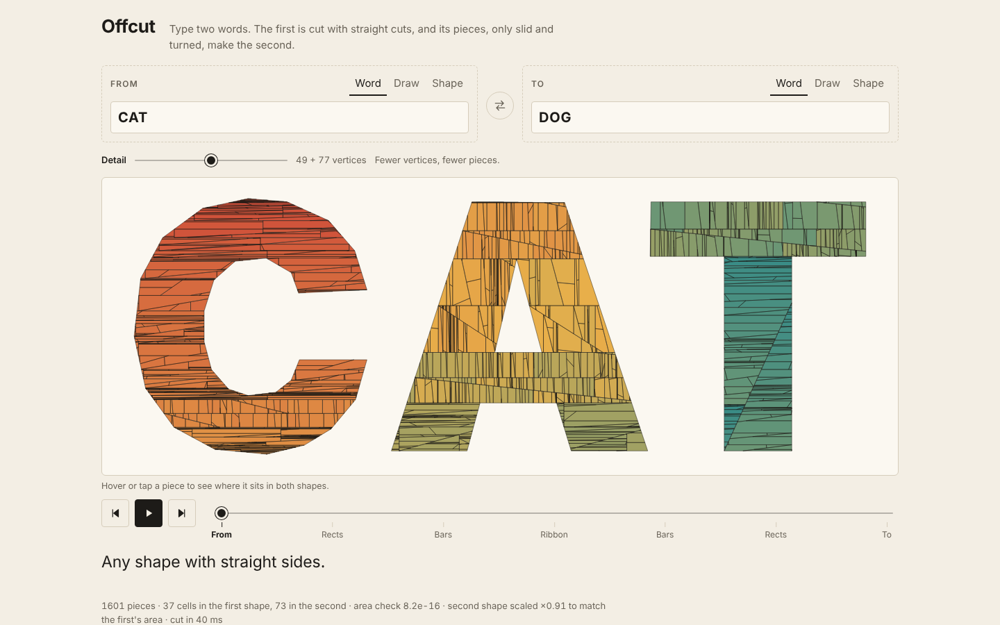
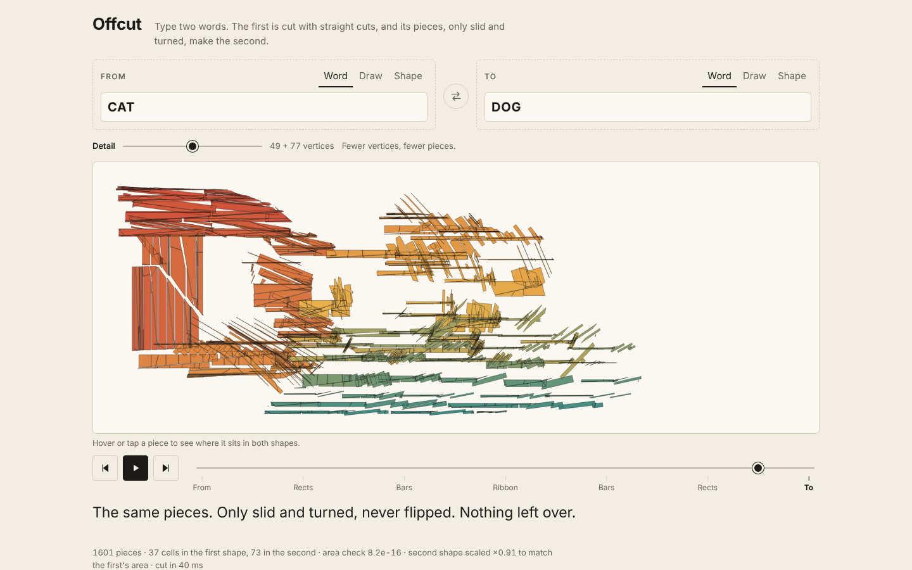
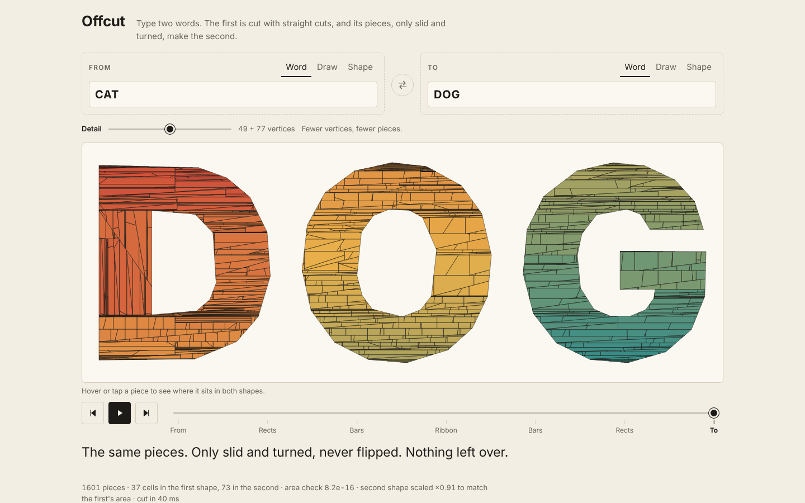
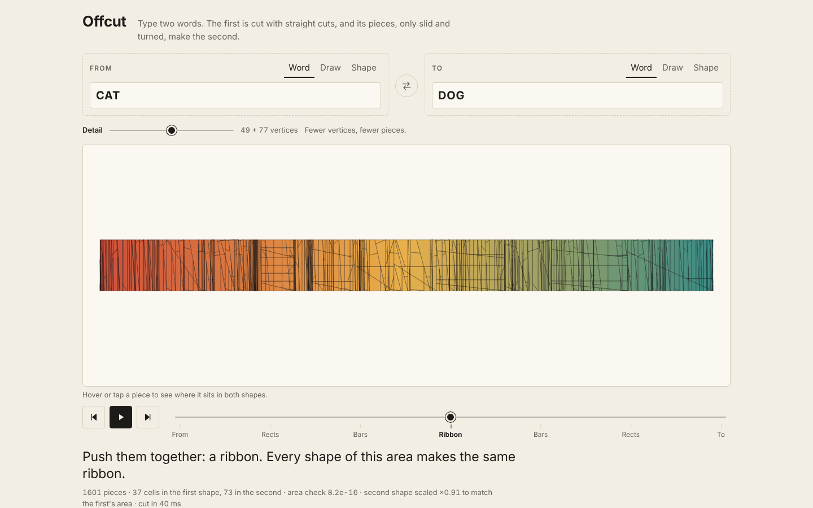
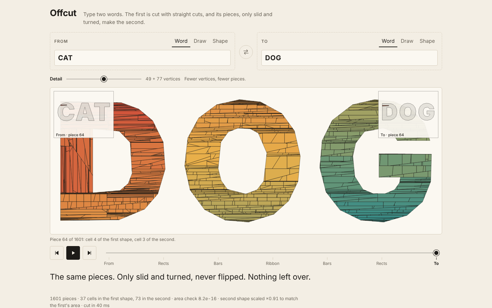

# Offcut

**Type two words. The first is cut into pieces with straight cuts, and the same
pieces, only slid and turned, make the second.** No piece is flipped over and
nothing is left over. It works for any two words, drawings or shapes, because it
is a theorem: any two polygons of equal area can be cut into finitely many
pieces that rearrange into each other (Wallace–Bolyai–Gerwien, 1807–1833).
Offcut does not illustrate the theorem. It carries out the proof on whatever you
give it, and then checks the result.

| CAT, cut into 1,601 pieces | The same pieces on their way | DOG |
|:---:|:---:|:---:|
|  |  |  |

| Every shape of the same area becomes the same ribbon | Hover a piece to see its place in both |
|:---:|:---:|
|  |  |

The colour of a piece is its position along the ribbon, so the marbling shows
where each part of the first shape ends up in the second.

## Run it

```bash
cd showcase/apps/offcut
python3 -m http.server 8080
# open http://localhost:8080
```

No build and no dependencies.

## Use it

- **From / To**: each side takes a word, a freehand drawing, or a preset shape.
- **Detail** sets how closely outlines are traced. Fewer vertices give fewer pieces: `CAT → DOG` is 995 pieces at the lowest setting, 1,601 at the default and 4,521 at the highest.
- **Timeline**: drag to scrub, Space to play or pause, ← and → to step between the seven stops.
- **Hover or tap a piece** to see where it sits in both shapes.
- **Puzzle (SVG)** downloads the second shape with every cut line and piece number, and the first shape's outline with the same numbers in place. **Frame (PNG)** saves the stage.
- **Copy link** puts both inputs in the URL.

## The proof it performs

1. Cut the shape into trapezoids by slicing through every vertex.
2. Turn each trapezoid into a rectangle: half-turn its top half about the midpoint of one side to get a parallelogram, then slide one triangle across.
3. Recut every rectangle to one common height. Fold it in half and stack until it is within a factor of two, then make the classic two-cut slide.
4. Push the bars together into one long rectangle, the ribbon.

Any shape of that area becomes the same ribbon. Cut the ribbon along both
shapes' lines at once, and every piece has a place in each shape. Play one
cutting forwards and the other backwards.

Three things the page says plainly, because they are easy to get wrong:

- **Curves are traced to straight sides first.** A circle is only approximately squared here. With scissors and finitely many pieces, squaring a true circle is impossible.
- **The second shape is scaled** to the first one's area, and the page says by how much. The theorem needs equal areas.
- **This is false in three dimensions.** A cube cannot be cut into a regular tetrahedron (Dehn, 1900).

## Checks

```bash
node tools/engine-verify.mjs       # the geometry, headless
node tools/stage-trace-test.mjs    # bitmap to polygons, headless
python3 -m http.server 8150 &
node tools/independent-check.mjs   # shares no geometry code with the other two
```

`engine-verify` runs 21 named pairs and 220 seeded random polygons, about a third
with holes, at coordinate scales from 1e-4 up to offsets of 1e6. For each it checks that every motion is
rigid and none is a reflection, that every piece is convex, that areas sum to
the shape's (worst relative error 1.1e-13), that no pieces overlap in any of the
seven frames, and that sample points of every piece lie inside the shape.

`independent-check` was written after the two halves were joined and uses neither
half's geometry. It loads the real page on twelve word and shape pairs, paints
every piece into a 2,400-pixel bitmap and compares coverage with the shape
painted the same way, then clips every pair of pieces against each other in all
seven frames.

| Pair | Pieces | Pixels that disagree, first / second shape | Overlap ÷ area |
|---|---:|---:|---:|
| CAT → DOG | 1,601 | 0.047% / 0.078% | 2.1e-14 |
| HELLO → WORLD | 1,734 | 0.058% / 0.097% | 2.1e-14 |
| jason? → Q&A! | 2,934 | 0.164% / 0.093% | 4.7e-14 |
| star → heart | 454 | 0.035% / 0.020% | 4.0e-15 |
| arrow → i | 131 | 0.018% / 0.003% | 1.9e-15 |

The disagreeing pixels are where stacks of slivers thinner than a pixel round up
in the bitmap. The overlap column is exact arithmetic on the polygons.

## How it was built

Two builders worked at the same time and never saw each other's code. One built
the Engine: `dissect(shapeA, shapeB)`, pure and DOM-free. The other built the
Stage: tracing, the film, the page. Between them was a written interface: shapes
as rings of points, a pose as `[cos, sin, tx, ty]`, and a result in which every
piece carries its pose in three key frames per side.

| Path | What |
|---|---|
| `js/engine.js`, `js/engine-*.js` | cells, rectangles, bars, ribbon, overlay |
| `js/trace.js`, `js/stage-raster.js`, `js/presets.js` | anything painted becomes polygons with holes |
| `js/stage-pose.js`, `js/stage-view.js` | rigid interpolation in screen space; the canvas |
| `js/stage-*.js`, `js/main.js` | inputs, timeline, share links, exports, worker |
| `dev/engine-view.html` | all seven frames side by side |
| `dev/stage-fake-engine.js` | the stand-in the Stage was built against |
| `tools/shots.mjs` | the screenshots |

## Caveats

- Piece counts are far from minimal. The construction is the textbook one, chosen because it always works; a clever dissection of two simple shapes can need a handful of pieces where this uses hundreds.
- Some pieces are slivers thousandths of a unit thick. They are real pieces and the arithmetic accounts for them, but nobody could cut them from paper. Turn Detail down for a puzzle you intend to cut.
- Tested in headless Chromium only. Frame rate was measured under software rendering, and touch input was not tried on a real device.
