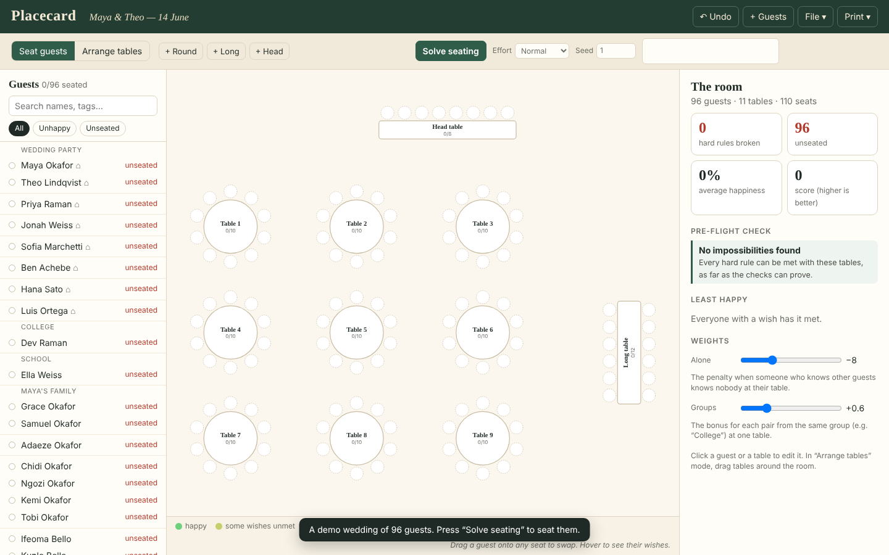
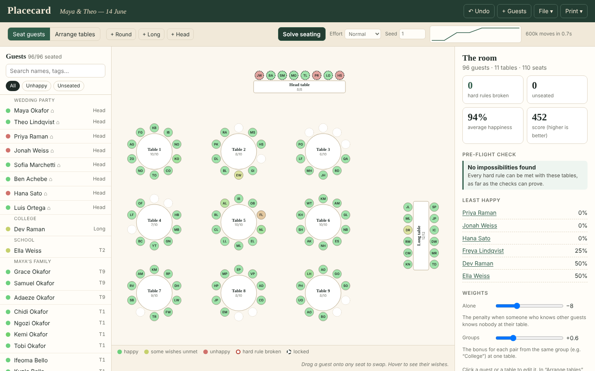
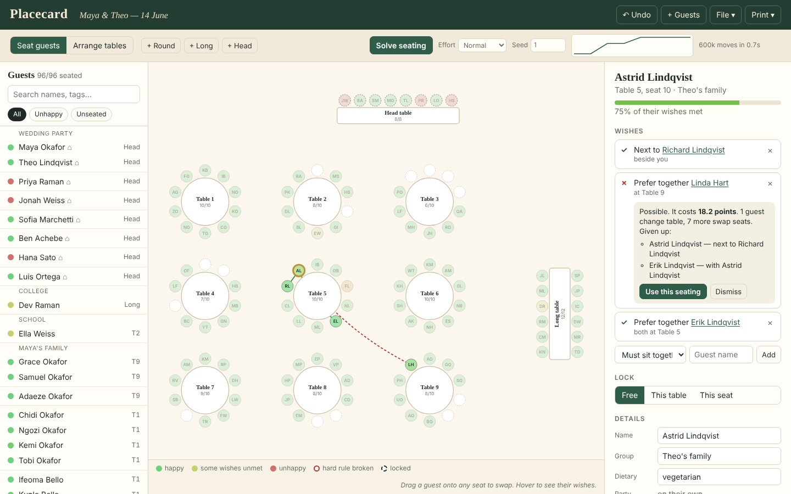
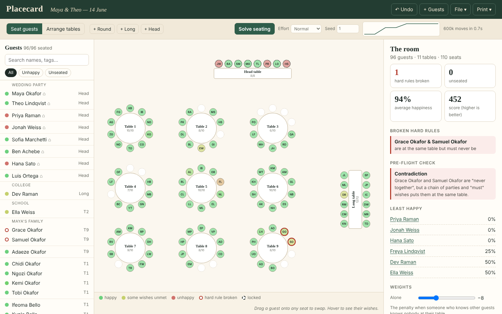
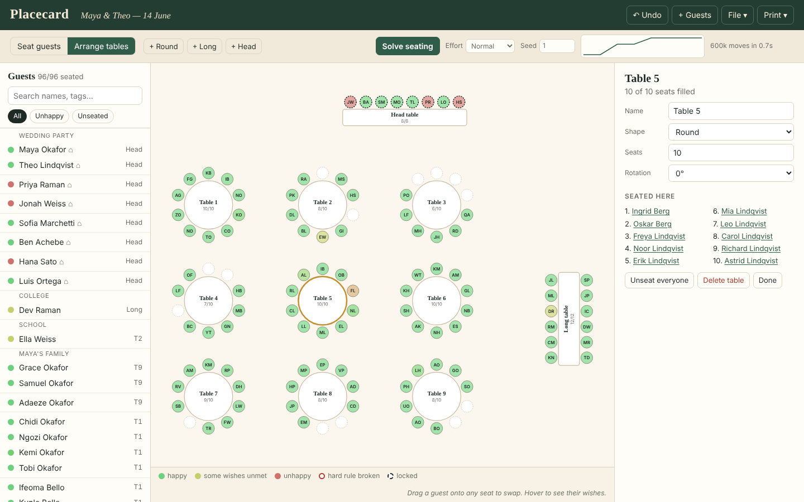
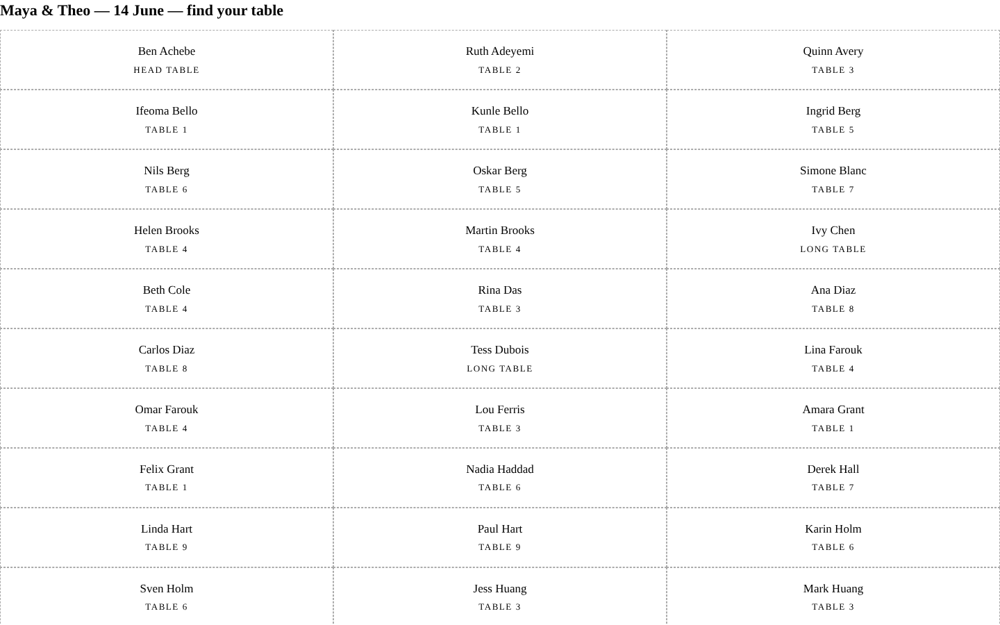
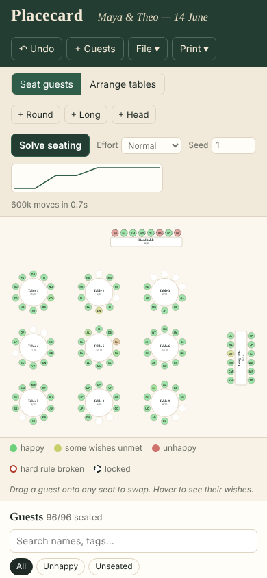

# Placecard

Seat every guest at a wedding or dinner in a specific chair, not just at a
table. When someone ends up unhappy, it tells you what fixing that would cost.

| Before: 96 guests, nobody seated | After one second of annealing |
|:---:|:---:|
|  |  |

| “What would it cost?” | The pre-flight check catching a contradiction |
|:---:|:---:|
|  |  |

| Arranging tables | Printed escort cards | Phone |
|:---:|:---:|:---:|
|  |  |  |

See [`PRD.md`](./PRD.md) for the full spec.

## What it does

- **Seats guests, not just tables.** Round tables know each seat's two
  neighbours and the seat across. Long tables have two facing sides, and a head
  table has one. "Next to" means the chair beside you.
- **Five kinds of wish.** *Must sit together* and *never together* are hard
  rules. *Next to*, *prefer together* and *prefer apart* are soft wishes.
  Parties (households) are implicit must-togethers that also want to sit side by
  side. There are two room-wide terms: a penalty for anyone who knows guests but
  knows nobody at their table, and a small bonus for keeping groups like
  "College" together.
- **A solver you can watch.** Simulated annealing runs in a Web Worker and
  streams its best seating to the floor plan as it goes, at about 900k moves/s.
  The score decomposes exactly by table, so a move re-scores only the two tables
  it touches. There are four move types:
  - seat swaps;
  - **group swaps**, which move a whole must-together group across tables (a
    couple can never change tables one person at a time);
  - **block swaps** of 2–4 neighbouring seats, so a chain of "next to" wishes
    can travel intact;
  - **three-way rotations**.

  The solver is seeded and deterministic.
- **A pre-flight check that proves impossibility.** It finds:
  - more guests than seats;
  - a must-together chain bigger than any table;
  - a "never" pair that a chain of parties and "must" wishes forces together;
  - must-together groups that **cannot be packed** into the tables (exact
    backtracking search, reported only when the search finishes);
  - conflicting locks;
  - anyone asking to be next to more than two people.
- **"What would it cost?"** Any unmet wish can be priced. The worker promotes
  that wish to hard and re-solves from the current seating. A small "stay where
  you are" bonus keeps the answer an edit rather than a reshuffle. The answer is
  the price in points, who moves, and which other wishes are given up, and you
  can apply it with one click. In the demo, seating grandma Astrid with Linda
  costs 18.2 points, because Linda's ex-husband is the son Astrid wants to sit
  beside.
- **Everything you need on the day.** Drag-and-drop swaps, seat and table
  locks, undo, and a paste importer (`Ana Ruiz (veg) & Tom Ruiz | Bride's family`).
  It saves and loads JSON, exports CSV, and prints escort cards, table rosters
  and folded place cards with dietary notes. It autosaves to localStorage.

## Running it

```bash
cd showcase/apps/placecard
python3 -m http.server 8080
# open http://localhost:8080
```

ES modules and the module worker need an HTTP server, so `file://` will not
work. On first load you get a 96-guest demo wedding. Press **Solve seating**.

## Using it

| Action | How |
|---|---|
| Add guests | **+ Guests**, one party per line: members split by `&` or `,`, then an optional `\| group` and an optional `(diet)` per name |
| Move someone | Drag them from the list or a seat onto any seat, which swaps. Or select them and click an empty seat |
| Add a wish | Select a guest, pick the wish type, type the other name, then **Add** |
| Lock | Select a guest, then **This table** or **This seat** |
| Tables | **+ Round / + Long / + Head**, then **Arrange tables** to drag them. Click a table to rename it, change its shape or seat count, or rotate it |
| Price a wish | Click **What would it cost?** under any ✗ |
| Print | **Print ▾**: escort cards, table rosters or folded place cards |

## Key parameters

| Parameter | Default | Meaning |
|---|---|---|
| Hard rule weight | ±1000 | Any seating that breaks no hard rule beats every one that does |
| Next to | +10 beside, +3 across, +4 same table | |
| Prefer together / apart | ±5 | |
| Party members beside each other | +6 | on top of the hard same-table rule |
| Alone penalty | −8 | adjustable in the room panel |
| Group bonus | +0.6 per pair | adjustable |
| Effort | 150k / 600k / 2.5M moves | ×(guests ÷ 100) for plans above 100 guests |

## Verification

```bash
node tests/bench.mjs
```

There are 15 checks, all passing:

- The incremental score equals a full recompute after 50k random moves.
- On a **planted** 60-guest instance (only wishes consistent with a hidden
  seating), the solver finds zero hard violations and a score ≥ the planted one.
- On 8 guests at two tables, it hits the **true optimum over all 40,320
  seatings**.
- Each lint rule fires on a hand-built impossible plan and stays silent on the
  demo.
- Locks hold after solving, the same seed gives an identical seating, and a
  what-if on an unlocked wish satisfies it.

## Files

```
index.html, style.css, main.js   app shell, state, drag & drop, IO
js/worker.js                     solver + what-if in a module worker
js/core/plan.js                  plan JSON → flat typed arrays (seats, weights, locks)
js/core/score.js                 per-table score, hard violations, per-guest explanation
js/core/solver.js                simulated annealing with group/block/cycle moves
js/core/lint.js                  pre-flight impossibility proofs
js/core/whatif.js                "what would it cost?"
js/core/demo.js                  the 96-guest demo wedding
js/ui/*.js                       floor plan (SVG), guest list, inspector, print
tests/bench.mjs                  verification bench (plain Node)
```

## Dependencies

None. It uses vanilla JS with ES modules, SVG and a Web Worker, and needs no
build step.
