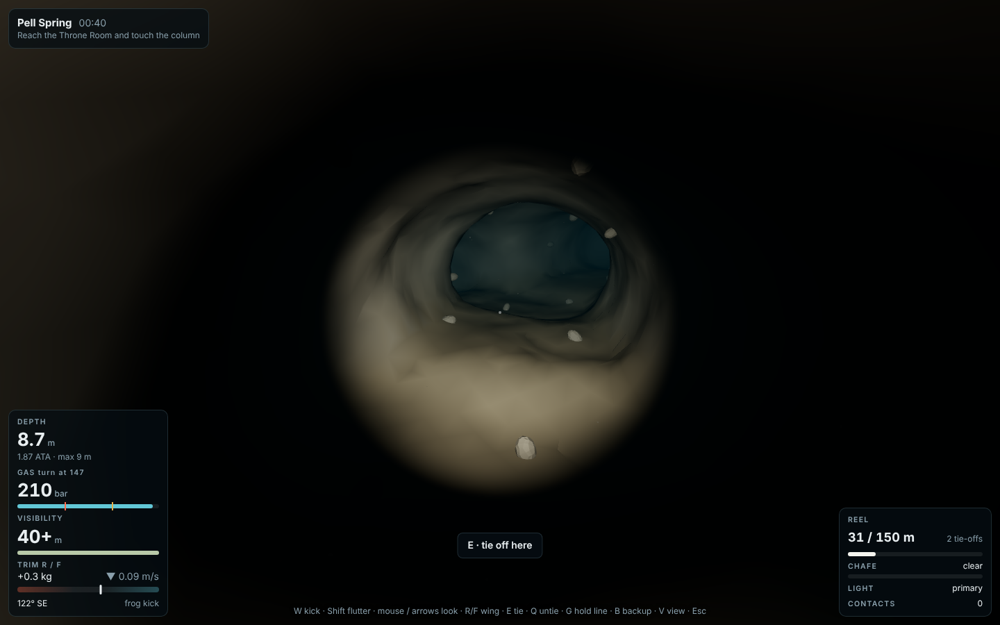
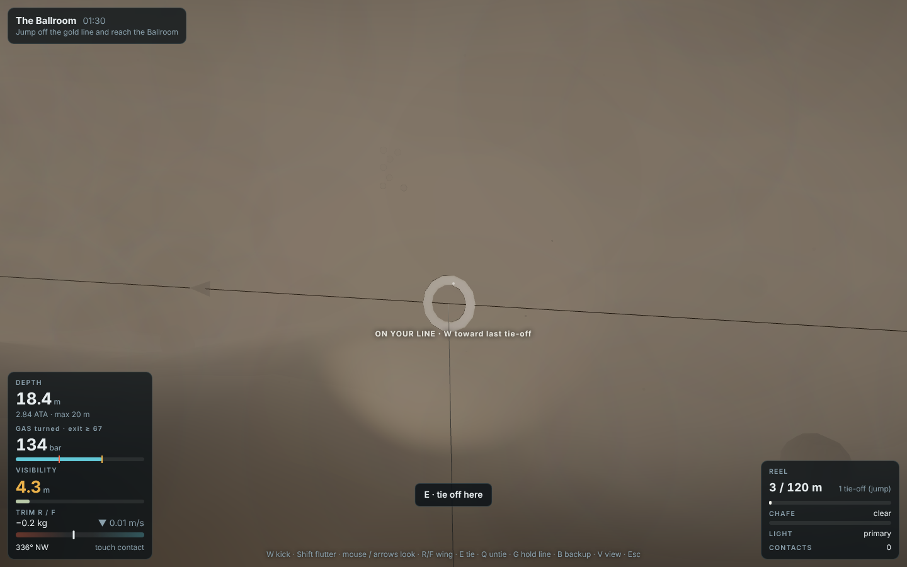
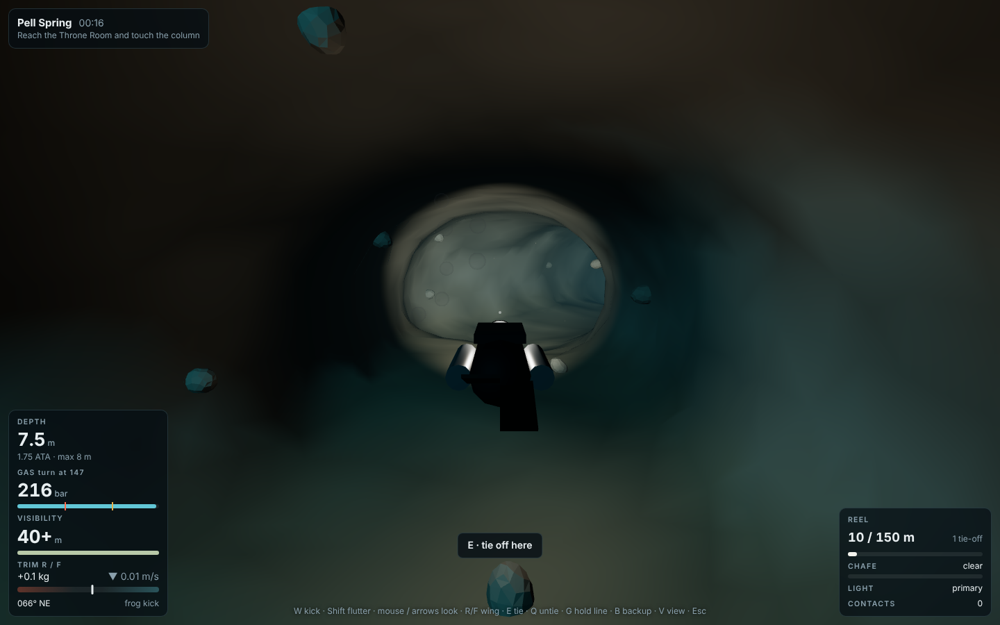
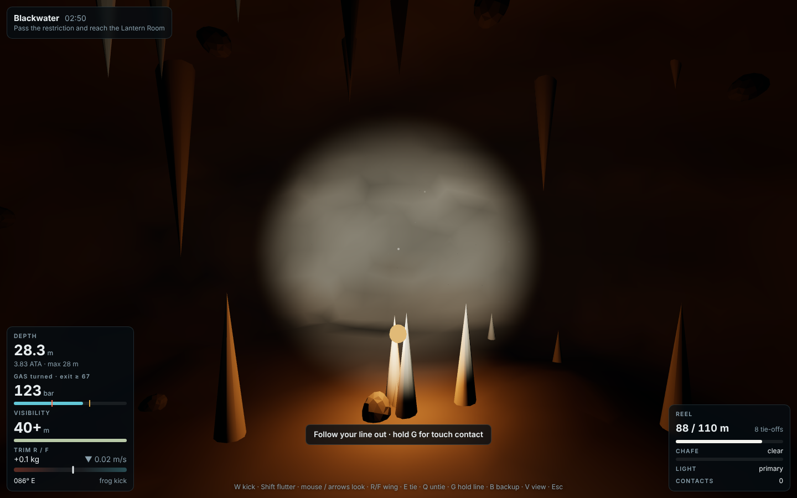
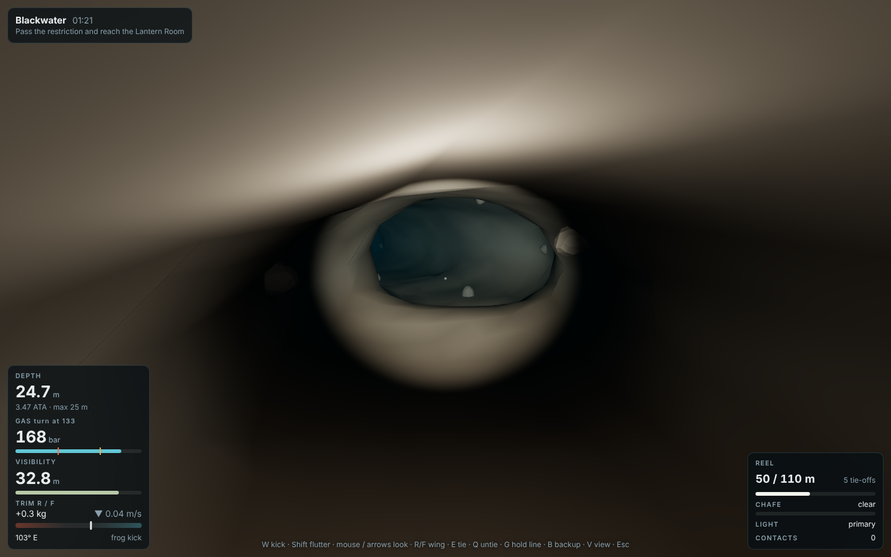
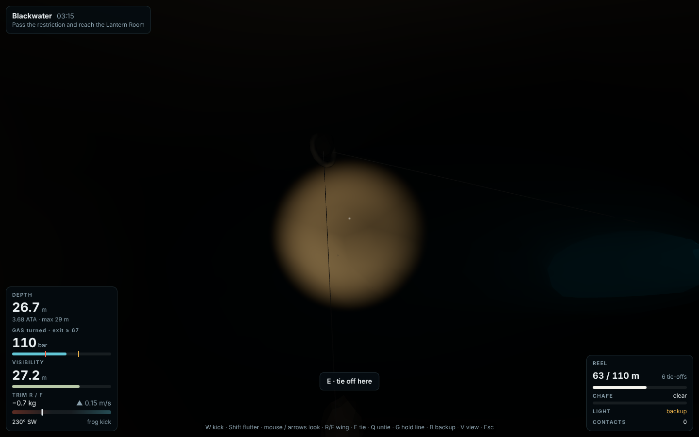
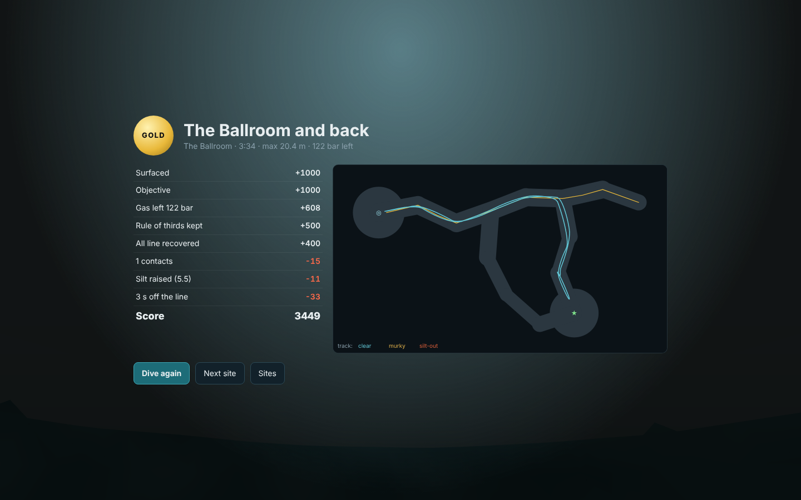
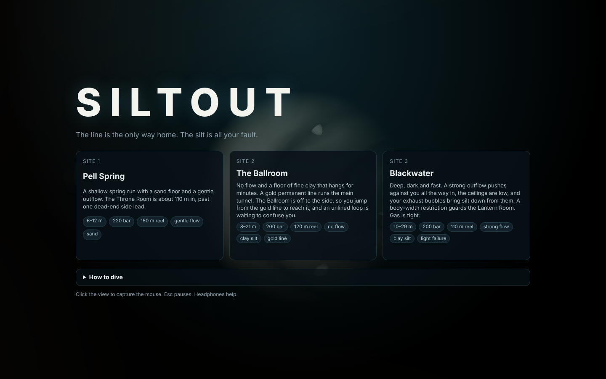
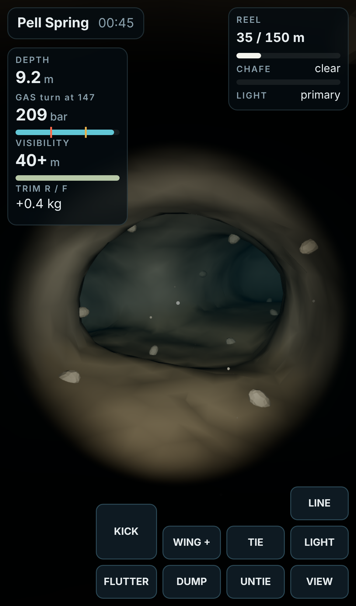

# Siltout

A 3D underwater cave-diving game. You swim into a flooded cave running a guideline
from a reel, and that line is the only way home once your own fins have turned the
water to mud. The way in is clear and quick. The way out is slow and murky, and
you untie each tie-off you made, in reverse order, by touch if you have to.

| Laying line | Silted out, on the line by touch |
|:---:|:---:|
|  |  |

| The basin and the primary tie-off | The Lantern Room |
|:---:|:---:|
|  |  |

| Blackwater's restriction | Primary light failed, backup on |
|:---:|:---:|
|  |  |

| Result and silt map | Title | Phone |
|:---:|:---:|:---:|
|  |  |  |

The full design is in [PRD.md](PRD.md).

## Run it

```bash
cd showcase/apps/siltout
python3 -m http.server 8080
# open http://localhost:8080
```

There's no build step. Three.js r163 is vendored in `vendor/`.

## Controls

| Key | Action |
|---|---|
| Mouse (click to capture) or arrows, A/D | look / turn |
| W · Shift+W · S | frog kick · flutter kick · back kick |
| R / F | add gas to the wing / dump it |
| E | tie off at a rock knob, jump onto a gold line, or splice a parted line |
| Q | untie the last tie-off and reel in |
| G (hold) | touch contact: slide along the line, W goes toward home |
| B | backup light |
| V | first person / chase camera |
| Esc | pause |

On a touchscreen you drag to look and use the on-screen buttons.

## How it works

- **Cave.** Each site is a hand-drawn graph of chambers and tunnels, turned into a
  signed distance field: varying-radius capsules and squashed spheres, a flat silt
  floor, a smooth union and two octaves of value noise. The same field drives
  collision, silt cells, the line-chafe test and the mesh, which is built with
  surface nets on a sparse block grid.
- **Buoyancy.** The wing stores a surface-equivalent volume, so the volume it
  displaces at depth is `Vs / ATA` (Boyle). Rising makes you more buoyant, which
  makes you rise faster. Breathing the tank down makes you lighter, and every
  breath moves 0.7 L of lung volume.
- **Gas.** Consumption is `SAC(mode) × ATA × stress` in bar/s. Stress (×1.3)
  applies when visibility is under 2.5 m, when you are off the line, or when you
  are in the dark. The HUD marks the turn pressure (⅔ of the start) and the
  thirds reserve (⅓).
- **Silt.** A 1.5 m voxel grid of extinction coefficient. Kicks within reach
  of a silty floor raise it (a flutter kick reaches 2.8 m, a frog kick 1 m).
  Wall contact raises it, and exhaled bubbles knock it off low ceilings. It
  diffuses between water cells and settles with a per-site time constant, and the
  spring flow carries it along conservative donor-cell faces. Visibility is
  `3 / (clarity + c)`, and plumes render as torch-lit sprites.
- **Line.** Fixed segments between tie-offs, plus a live segment from the last
  tie-off to your hand. If the live segment passes through rock it chafes, and at
  100% wear it parts. The reel length is a hard tether.
- **Flow.** Spring discharge follows the graph path from the vent to the basin,
  at `Q / area`, so it runs faster through restrictions.

## Sites

| Site | Depth | Flow | Silt | Twist |
|---|---|---|---|---|
| Pell Spring | 6–12 m | gentle | sand, settles in 10 s | one dead-end side lead |
| The Ballroom | 8–21 m | none | clay, hangs for 70 s | jump off a gold permanent line, unlined loop |
| Blackwater | 10–29 m | strong | clay + ceiling percolation | restriction, primary light fails on the way out |

**Grading.** Bronze means you surfaced. Silver adds the objective, at least 20% gas
and less than 30 s off the line. Gold adds the rule of thirds, all line recovered,
fewer than 5 contacts, no parted line and little silt.

## Checks

```bash
node scripts/bench.mjs
```

The bench runs headless and checks:

- every passage is open along its axis
- Boyle's law for the wing, and neutral buoyancy at the start depth
- gas use scales with ATA
- silt mass is conserved under diffusion and advection
- flow carries a plume toward the basin
- chafe detection
- the reel tether
- identical runs give identical results
- mesh vertices lie on the rock surface

It then runs three autopilots on every site. The expert takes gold, the no-tie-off
diver parts its line, and the flutter kicker silts out the clay caves.

`node scripts/screens.mjs` (with the folder served on :8097) regenerates the
screenshots. `window.__siltout` exposes hooks for scripting.

## Files

```
src/sites.js   cave graphs and per-site parameters
src/cave.js    distance field, flow, tie-off points, gold line
src/silt.js    voxel silt: sources, diffusion, flow, settling
src/sim.js     diver, buoyancy, gas, reel, chafe, scoring
src/bot.js     autopilots for the bench and screenshots
src/mesh.js    sparse surface nets
src/scene.js   Three.js rendering, torch-lit silt, line, diver
src/hud.js     gauges, prompts, result map
src/audio.js   synthesised regulator, bubbles, clicks
```
