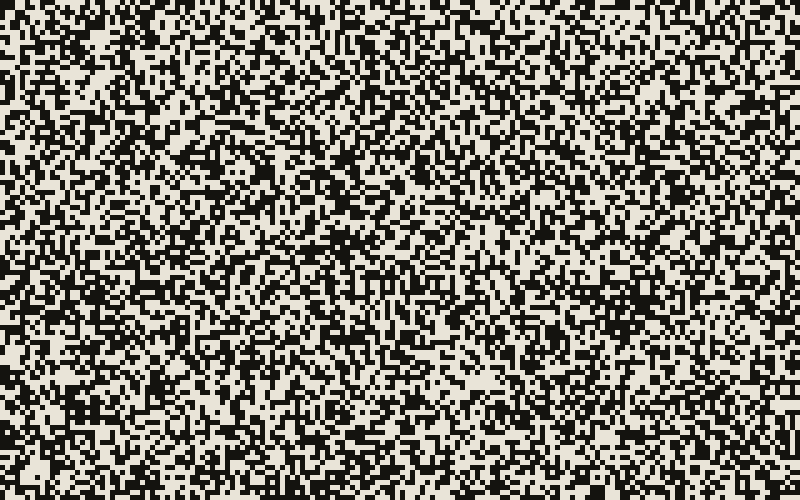
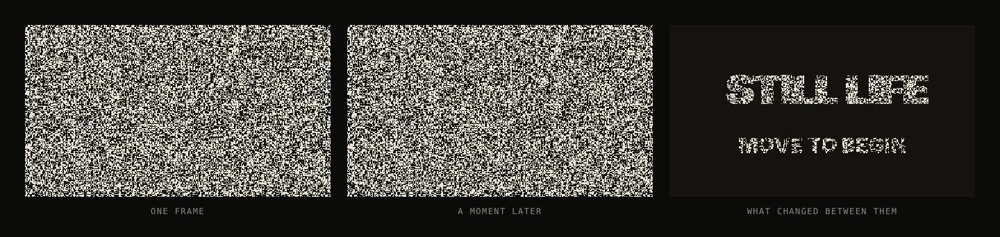
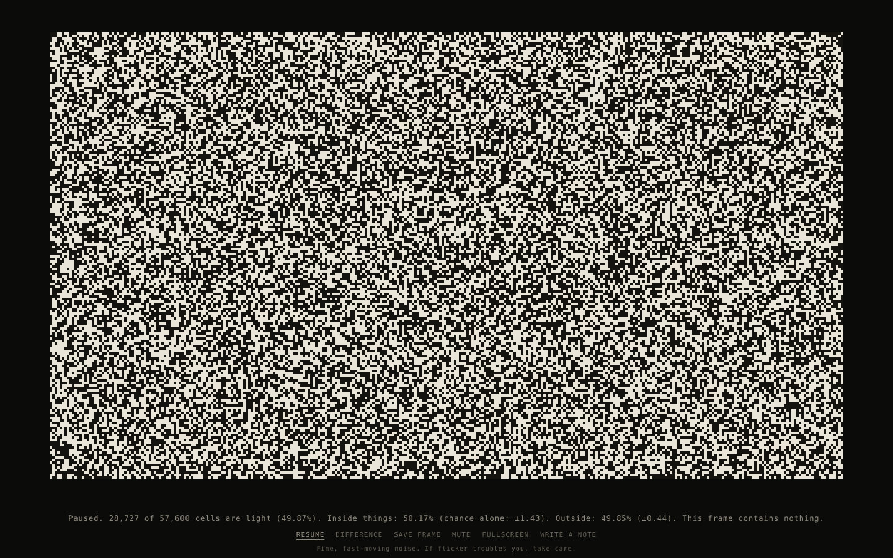
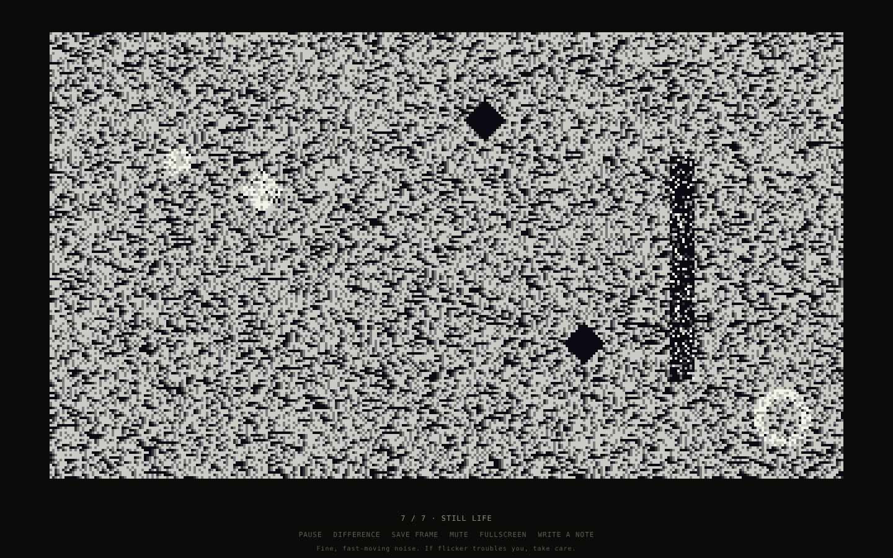

# Still Life

**A game in which every frame is random noise.** The screen is a 320 × 180 grid
of fair coins. A thing is a patch of noise that moves differently from the noise
around it, so shapes exist only in the change between frames. Pause it and the
world is gone. A screenshot is static. The game has one rule, and the renderer
makes it true without being asked: anything that holds still does not exist.

| The cover is animated, because a still one would be blank | Two frames, and what changed between them |
|:---:|:---:|
|  |  |

| Paused: the same level, with nothing in it | The last level, seen through the difference view |
|:---:|:---:|
|  |  |

Every other picture here was taken through the difference view, which lights the
cells that changed since the previous frame. That is roughly what your visual
system does with the game. The game itself never shows it unless you hold `X`.

## Run it

```bash
cd showcase/apps/still-life
python3 -m http.server 8080
# open http://localhost:8080
```

No build and no dependencies.

## Play

| Key | Does |
|---|---|
| Arrows / WASD, or drag on a touch screen | Move. It is the only verb |
| `P` / `Esc` | Pause, and read the receipt |
| hold `X` | Difference view |
| `C` | Save the current frame as a PNG. There is nothing in it |
| `M`, `F` | Mute, fullscreen |

You are a disk. While you move you can see yourself. When you stop you vanish,
from the screen and from the seekers, who see exactly what you see. They stop
too, to listen, and then you have to remember where they were.

Seven levels, each adding one consequence of the rule:

1. **Move** — you exist while you move.
2. **Hold still** — a seeker patrols. Freeze when it is near.
3. **They stop too** — a seeker that stops is invisible and silent.
4. **Glass** — walls that do not move cannot be seen. Bump one and it shivers into view; the knock brings company.
5. **Gather** — three sparks open a gate that is not there until they do.
6. **Current** — rivers. Drift with one and you are at rest in it, so you vanish. A seeker standing in a river is a visible island.
7. **Still life** — the whole ground drifts, and the rule turns over: doing nothing carries you unseen, and standing your ground is what shows.

At the start of each level one sweep crosses the screen and nudges everything
once. That glimpse is all you get.

Sound follows the same rule. Only moving things make any.

## Write a note

"Write a note" turns a short message into a link. Whoever opens it can read the
message, and cannot photograph it: any single frame is noise. A video would
capture it, and so would two screenshots and a subtraction.

## How it works

One rule draws everything (`js/eye-core.js`). For each cell, find the topmost
item covering it, and show that item's own noise texture at that cell, shifted by
the item's position and texture offset. If nothing covers it, show the ground's
texture. Each texture is a hash of `(id, x, y)` that returns a fair coin.

- An item whose position and offset do not change is the same coins every frame, and cannot be told from the ground.
- Move it and its coins move with it: a rigid body.
- Leave it in place and slide its texture: a shape that flows without going anywhere. Gates, sparks, rivers and text.
- Re-flip a fraction of its coins each frame: a wall that simmers.
- Slide the ground's texture and everything that stays put becomes an island.

Every cell is drawn from exactly one independent fair coin, so a frame carries no
information about what is in it. This only holds with whole cells: no blending,
no smoothing, integer positions, integer scaling. A half-cell step would need a
grey, and a grey is an outline.

The seekers use the same rule as the screen. An entity is visible on a tick only
if its displacement differs from that of the medium under it, and that is the
only thing a seeker is told about the player.

## Checks

```bash
node tools/eye-verify.mjs   # the renderer
node tools/world-sim.mjs    # the game
```

`eye-verify` composes scenes with moving, flowing, simmering, overlapping and
off-grid items and tests the frames at 4σ: share of light cells overall, inside
items and outside them; correlation between a cell and whether it belongs to an
item; neighbour correlation, including across item edges; that a still scene
changes zero cells; that a moving item changes cells only inside its old and new
footprint; and agreement with a slow per-cell reference.

`world-sim` checks that every scene the game emits is integer; that a player
giving no input never moves on still ground and moves by exactly the river's
displacement in a river; that a listening seeker's position is constant; that a
bot which freezes when watched clears all seven levels; that a bot which never
stops is caught; and that seekers do not get stuck.

The bot plans with look-ahead on the real simulation, so it shows each level can
be finished, not that it is easy.

## How it was built

Two builders worked at the same time and never saw each other's code. One built
the Eye: the compositor, the canvas, the page, the note. The other built the
World: the simulation, seekers, levels, input and sound. The only thing between
them was a written interface, the scene described above, and `js/shape.js`.

| Path | What |
|---|---|
| `js/shape.js` | masks: the only geometry there is |
| `js/eye-core.js`, `js/eye.js` | the rendering rule, and the canvas around it |
| `js/main.js`, `js/note.js` | the loop, shell keys, pause receipt, notes |
| `js/world*.js`, `js/levels.js` | the game |
| `js/input.js`, `js/audio.js` | keys and touch; synthesised sound |
| `dev/eye-demo.html` | every material, on a fake world |
| `dev/world-truth.html` | the game drawn in flat colour, with `[` `]` to change level |
| `tools/make-cover.mjs`, `tools/shots.mjs` | the animated cover and the screenshots |

## Caveats

- It is fine, fast-moving noise. Anyone sensitive to flicker should take care.
- Nobody involved in building it could watch it move. Legibility was judged from difference images, and the sound has never been listened to.
- Tested in headless Chromium only.
