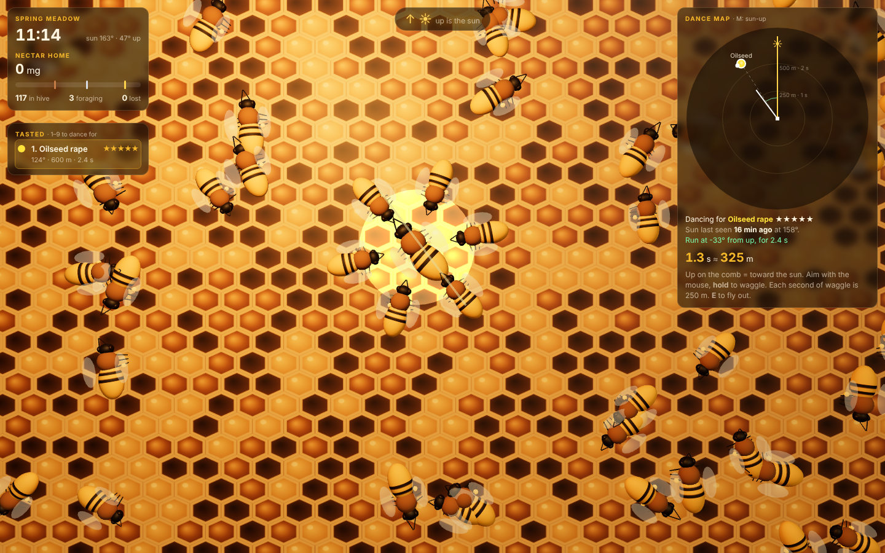
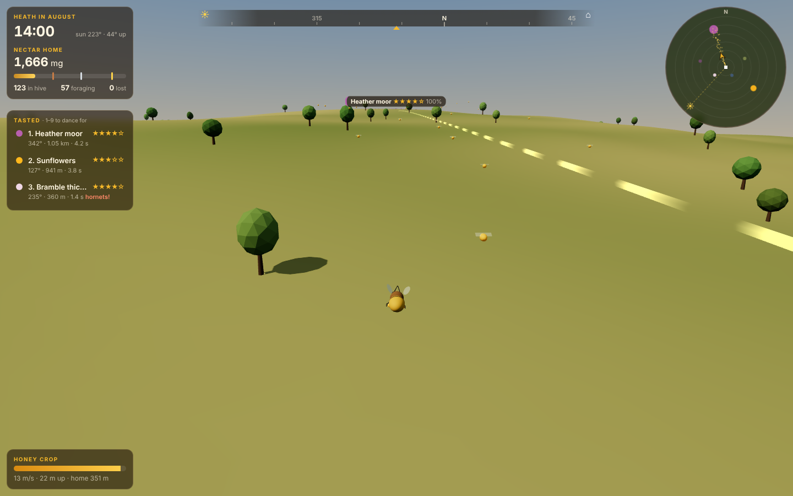
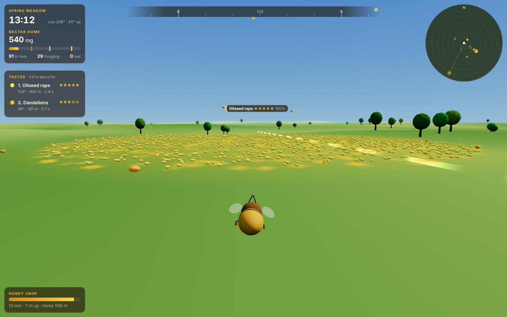
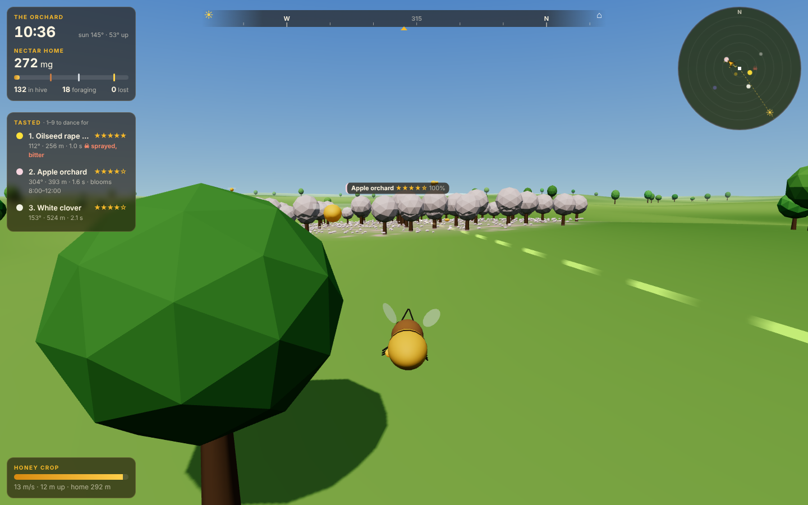
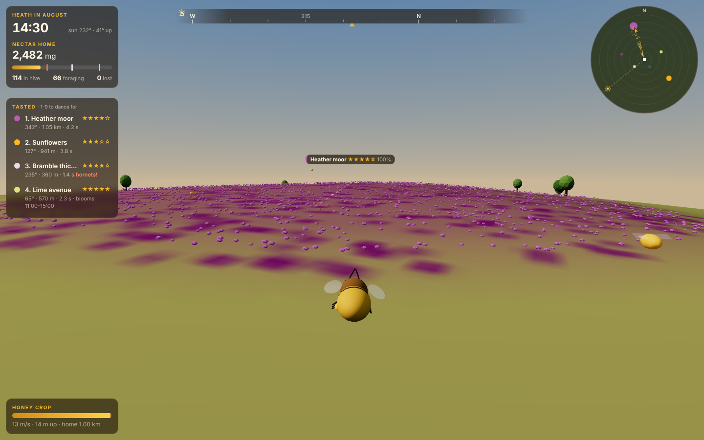
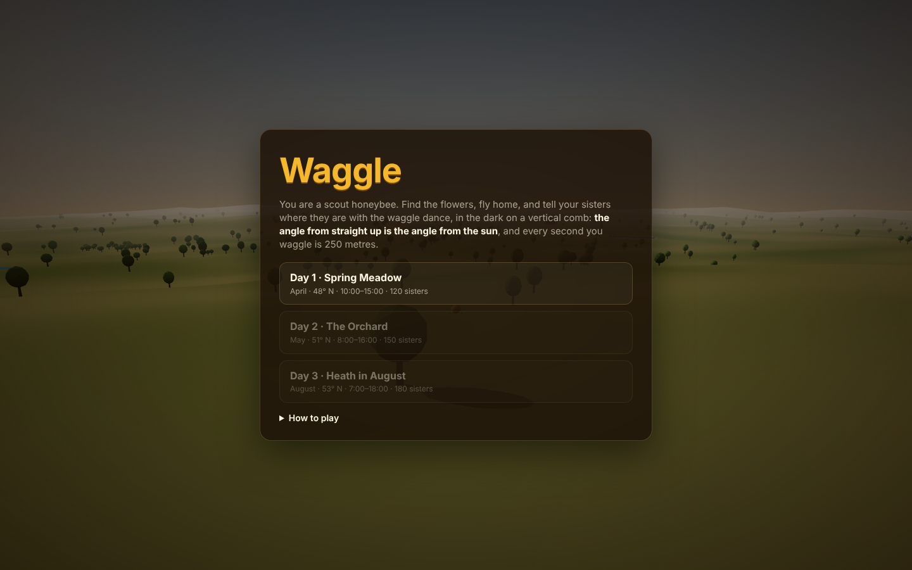
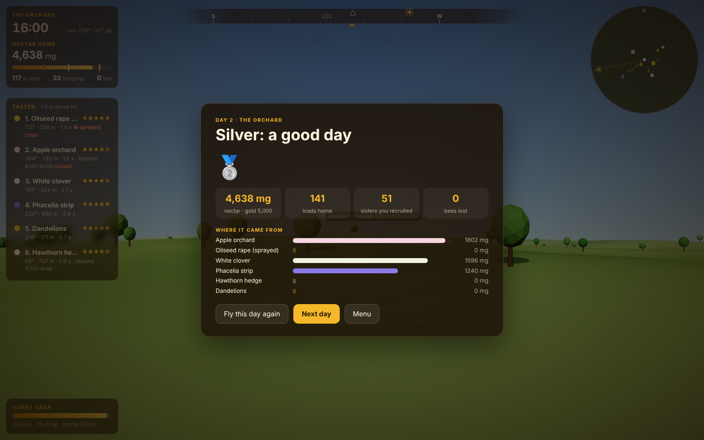
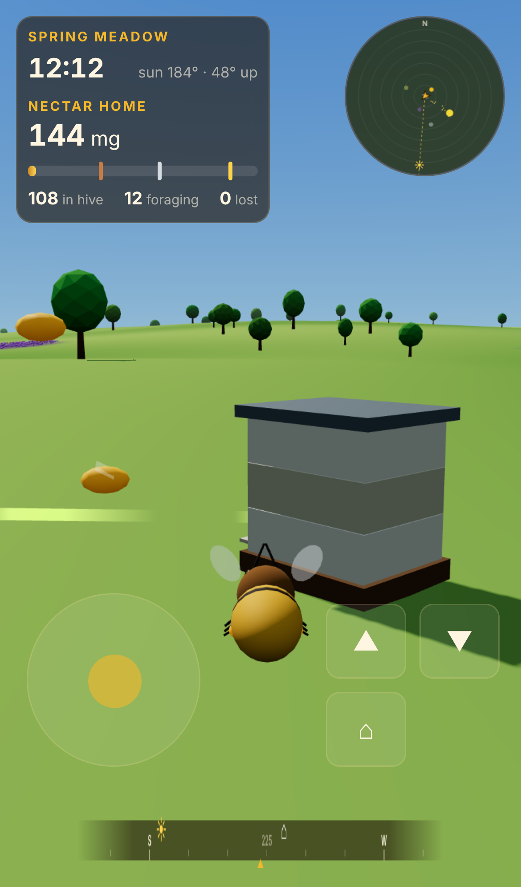

# Waggle

**A 3D honeybee game in which your only way to fetch nectar is to describe where it is.**
You are a scout. You fly out over the countryside, taste the flowers, and fly
home. In the dark on a vertical comb, you dance. The angle of your waggle run
away from straight up is the angle of the flowers away from the sun, and every
second you waggle is 250 metres. The sisters crowding round you watch a few
runs, average them, add their own error and fly what you said. If they find
something, they dance too.

| A waggle run on the comb | Bee line to the heather |
|:---:|:---:|
|  |  |

| Oilseed rape, Spring Meadow | Apple blossom, the Orchard | On the heather moor |
|:---:|:---:|:---:|
|  |  |  |

| Title | End of day | Phone |
|:---:|:---:|:---:|
|  |  |  |

## Run it

```bash
cd showcase/apps/waggle
python3 -m http.server 8080
# open http://localhost:8080
```

No build step and no network: Three.js r163 is vendored in `vendor/`. The PRD is
in [`PRD.md`](PRD.md).

## How it plays

**Scout.** Fly a third-person bee over about 3 km² of countryside. Flower
patches show as coloured drifts. Drop below 6 m and slow down over one, and a
second of sipping records its sweetness, any poison, its bloom window, and its
bearing and distance from the hive. (That is path integration, which real bees
do too.) Sipping also refills your honey crop, which drains as you fly and
faster on boost.

**Dance.** Fly into the hive entrance, or press **E** near it. You land on a
vertical comb, and up is the sun. Aim with the mouse and **hold** to waggle.
Your heading chases the aim, but the crowd keeps bumping you, so keep steering.
When you release, you loop back round (alternating sides, as real dancers do)
for the next run. The dance map shows the hive, distance rings, the patches you
have tasted, and every run you have made as a dot where it points. The guide
(**G**, on by default on day 1) prints the angle and duration to aim for.

**The sun moves.** One sim second is one minute of daylight, and the sun's
azimuth follows the real solar track for that day's latitude and declination,
so near noon it moves at up to 26° an hour. Inside the hive you only know where
it was when you came in. A long dance goes stale, and a bench test shows that
dancing 40 minutes after your last sighting puts recruits 27° off. Leave, look,
and come back.

**The colony.** Up to six followers attend your dance. Each watches 3–5 runs
and then either signs up, with odds rising with the quality of the patch you are
dancing for and dropping if your runs disagree, or wanders off and is replaced.
A recruit flies `sun(at the run) + mean angle` for `mean duration × 250 m`, with
angular noise of `4° + 22°·e^(−d/280 m)` (short dances are sloppier, as they are
in real bees) and 7% distance noise. It then searches a widening spiral for 16 s.
If it finds a patch it becomes a forager: shuttle, forage, unload, and sometimes
dance accurately itself, which recruits more. A green ring marks where a recruit
of yours found flowers, and a red one where it found nothing. On the map, golden
dashed bee lines thicken with traffic.

**Patches** have a stock (in loads) that foragers drain and that regrows while
they are open. A forager gives up after two empty trips. Some patches only bloom
in a window: the apples close at noon, and the limes open 11:00–15:00. The
sprayed rape kills half the bees that visit it. Hornets take one in eight
visitors at the bramble.

## Controls

| | Flying | On the comb |
|---|---|---|
| Steer / aim | **A D** or click and move the mouse | move the mouse · **A D** nudge |
| Speed | **W** faster · **S** slow (to taste) · **Shift** boost | |
| Height | **Space** climb · **C** dive | |
| Waggle | | hold **mouse** or **Space** |
| Hive | **E** go in (near the entrance) | **E** fly out |
| Other | **V** camera · wheel zoom · hold **Tab** for 4× time | **1–9** dance for a tasted patch · **M** north-up / sun-up map · **G** guide |

**Esc** returns to the menu. On a phone there is a steering pad plus climb,
dive, hive and waggle buttons, and in the hive you drag to aim.

## Days

| Day | Hours | Colony | What's going on | Bronze / Silver / Gold (mg) |
|---|---|---|---|---|
| 1 · Spring Meadow | 10:00–15:00 | 120 | Big rape field at 680 m. Morning-only crocus | 1,200 / 2,200 / 3,400 |
| 2 · The Orchard | 08:00–16:00 | 150 | Apples close at noon, sprayed rape next to the hive, phacelia far off | 1,800 / 3,200 / 5,000 |
| 3 · Heath in August | 07:00–18:00 | 180 | Heather 1.2 km uphill, limes at midday, hornets | 3,000 / 5,200 / 7,600 |

Each day unlocks on a bronze from the one before. Bests are kept in
`localStorage`.

## Bench

```bash
node scripts/bench.mjs
```

The bench runs the simulation headless (`sim.js` has no DOM or Three) and checks:

- **Determinism.** The same seed gives an identical day.
- **Solar track.** On each day the sun is at 180° at noon, always moves
  clockwise, and moves fastest at noon.
- **Decoding.** For a careful dance, recruits' mean bearing is within 3° and
  their mean distance within 5% (seed 3: 35 recruits, 0.1°, 1.3%).
- **Stale sun.** 40 minutes late near noon, recruits miss by more than 10°.
- **Poison.** Dancing the sprayed field kills bees. A scout who tastes first
  loses none.
- **Conservation.** Every bee is accounted for on every step, and the nectar
  ledger closes exactly.
- **Strategy.** An honest bot that scouts nearest-first and dances against the
  sun it last saw makes bronze on every day across three seeds. An expert bot
  (big fields first, with a perfect internal clock) beats a random-angle dancer
  by more than 5×, and doing nothing scores 0.

`scripts/screens.mjs` regenerates the screenshots (serve the folder on :8097
first).

## Files

| File | |
|---|---|
| `src/world.js` | days, patches, terrain noise, solar position |
| `src/sim.js` | deterministic sim: flight, tasting, dance, followers, foragers, patches |
| `src/bot.js` | autopilot scout used by the menu demo and the bench |
| `src/scene.js` | Three.js countryside, bees, bee lines, hive interior and comb |
| `src/hud.js` | compass tape, minimap, memory list, dance map |
| `src/audio.js` | Web Audio wing buzz, hive murmur, 15 Hz waggle buzz, cues |
| `src/main.js` | input, loop, menus |
